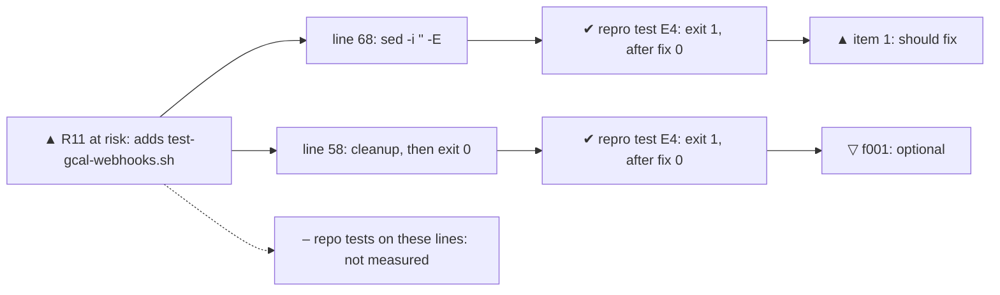

## ▲ PASS with follow-ups: cal.com `30a92a4..5fd11f9`

**0** must fix · **1** should fix · **6 to check by hand** · **7** optional

**Next:** fix item 1 or reply `decision: <why>`, then do checks 2 to 7.

> [!IMPORTANT]
> **7 things need you: 1 fix, 6 checks.** A PASS does not cover the checks: arbiter raised them and could not verify them.
> - [ ] **1 ▲ Fix: `sed -i ''` breaks on GNU sed.** On Linux the .env stays unchanged and the script still prints success. Proven by a failing test. [`scripts/test-gcal-webhooks.sh:68`](https://github.com/calcom/cal.com/blob/5fd11f9faa79c4aefd39975d1b0e963e5034f793/scripts/test-gcal-webhooks.sh#L67-L73)
> - [ ] **2 ○ Run lint, type check and tests yourself.** eslint, tsc and jest gave no result: the tools were not installed. Only semgrep analysed code.
> - [ ] **3 ○ Confirm R12, R13 and R14 are in this PR.** No version bump, no getSchedule change (#22574), no integrations-handler change in the diff. Raised as a blocker, dropped unjudged. `apps/web/package.json:11`
> - [ ] **4 ○ R3: is the cache menu limited to subscribed calendars?** No code reads `googleChannelId`. `CredentialActionsDropdown.tsx:69`
> - [ ] **5 ○ R6: should deleteCache go through the repository?** It calls `prisma.calendarCache.deleteMany` directly. `deleteCache.handler.ts:28`
> - [ ] **6 ○ R7: add an assertion for `updateManyByCredentialId`.** The existing test is reported to pass with the call removed. `CalendarService.test.ts:1024`
> - [ ] **7 ○ Review the shell script and the migration by hand.** No rules for .sh, .sql, .prisma, .json; ops axis not triggered; the threat model is arbiter's own draft.

Requirements: 14, **1** at risk, **6** need a human, **7** no conflict found. – Not measured: branches, tests, oracle strength.

<details><summary>Evidence and fix for item 1</summary>

```sh
if grep -q '^GOOGLE_WEBHOOK_URL=' "$ENV_FILE"; then
  sed -i '' -E "s|^GOOGLE_WEBHOOK_URL=.*|GOOGLE_WEBHOOK_URL=$TUNNEL_URL|" "$ENV_FILE"   # line 68
```

| `bash arbiter_proofs/arbiter_proof_f002.sh` | Exit | Last line of output |
|---|---|---|
| before the fix | 1 | `RESULT: env NOT updated despite success message` |
| after the fix | 0 | `RESULT: env updated` |

**Trigger:** the script runs on Linux and .env already contains GOOGLE_WEBHOOK_URL.
**Fix:** check sed's exit status, or use `sed -i.bak` and remove the .bak file.

</details>

<details><summary>Requirements: 7 of 14 need a look</summary>

| Requirement | Status | Why | Item |
|---|---|---|---|
| **R11** adds `scripts/test-gcal-webhooks.sh` | ▲ at risk | .env not updated on Linux | 1, f001 |
| **R3** dropdown only for subscribed calendars | ○ needs a human | `googleChannelId` is never read | 4 |
| **R6** cache access through the repository | ○ needs a human | `deleteCache` calls Prisma directly | 5 |
| **R7** webhook refresh updates `SelectedCalendar.updatedAt` | ○ needs a human | no test asserts the new call | 6 |
| **R12** integrations handler returns no value | ○ needs a human | change not found in the diff | 3 |
| **R13** #22574: getSchedule returns 400 | ○ needs a human | change not found in the diff | 3 |
| **R14** release v5.5.1 | ○ needs a human | version not bumped in the diff | 3 |

✔ No conflict found on the other 7 (R1, R2, R4, R5, R8, R9, R10): the spec check ran and no reported finding touches them. That does not prove they are implemented or tested.

</details>

<details><summary>Gates: 1 of 4 gave a result</summary>

| Gate | Result | Runs | Exit | What the log shows |
|---|---|---|---|---|
| semgrep p/typescript | ✔ ran clean | 5 | 0 | JSON output, no rule hit |
| eslint | – no result | 5 | 1 | `npx canceled due to missing packages`; 0 bytes of output |
| tsc | – no result | 4 | 1 | `ENOTCACHED`: npx found no local tsc; 0 bytes of output |
| npm test | – no result | 1 | 127 | `sh: 1: jest: not found` |

The command ran, the tool did not: npx or npm exited in 1.4 to 4.6 s before eslint, tsc or jest started. Root cause: `npm install --ignore-scripts --no-package-lock` exited 1 (`ERESOLVE`) in all 5 package roots, on head and on base.

</details>

<details><summary>Optional: 7 findings, none blocking</summary>

| Id | Where | Problem | Evidence | Req |
|---|---|---|---|---|
| f001 | `scripts/test-gcal-webhooks.sh:58` | failure paths call cleanup, which does `exit 0` | proven E4: repro exits 1, after fix 0 | R11 |
| f007 | `packages/trpc/server/routers/viewer/calendars/deleteCache.handler.ts:25` | plain `Error` becomes a 500 instead of NOT_FOUND | proven E4: `Error code: undefined`, after fix `TRPCError code: NOT_FOUND` | R4 |
| f005 | `packages/features/apps/components/CredentialActionsDropdown.tsx:79` | icon-only button has no accessible name | proven E1: 0 `aria-label` in the file | R2 |
| f006 | `packages/features/apps/components/CredentialActionsDropdown.tsx:89` | hard-coded `"en-US"` locale | proven E1: line 89 | R2 |
| f011 | `apps/web/package.json:11` | `npx tsx` is not pinned (CWE-829) | proven E1: 0 `"tsx"` entries in both package.json files | R10 |
| f004 | `packages/features/apps/components/CredentialActionsDropdown.tsx:53` | duplicated credentials.delete mutation | precedent `DisconnectIntegration.tsx:26` | R2 |
| f009 | `packages/trpc/server/routers/viewer/calendars/_router.tsx:29` | inline input schema (rule ET74) | precedent `setDestinationCalendar.schema.ts:3` | R4 |

</details>

<details><summary>R11 trace: 2 proofs reproduce, 0 repo tests measured</summary>

| Code | Proof run | Finding |
|---|---|---|
| line 68: `sed -i '' -E` | ✔ repro test E4: exit 1, after fix 0 | ▲ item 1 should fix |
| line 58: `cleanup`, then `exit 0` | ✔ repro test E4: exit 1, after fix 0 | ▽ f001 optional |



</details>

<details><summary>How the review ran: 16 candidates, 59 agent runs, 27 min 46 s</summary>

| Fact | Value |
|---|---|
| Candidates | 16 raised: 8 reported, 3 false positives (f003, f008, f010), 1 duplicate, 4 never judged (checks 3 to 6) |
| Change | 17 files, +379 −31, 6 units; all 8 findings sit in u01, u03 and u06 |
| Axes | 20 of 21 checked; not triggered: ops |
| Proofs | 7 attempted, 6 confirmed |
| Effort | standard; 59 agent runs, 33 verifier calls |

</details>

Full report with every proof: `report.html` in the run directory.

<!--
Mock-up notes (not part of the generated comment):
- Hand-written for research/research-report-ux.md from eval/results/martian/20261123233602/calcom-cal-com-pull-22532/.
- R1 to R14 number the run's 14 claims in order; finding-to-requirement links are a hand join by file name. The run predates requirement ids and `addresses`.
- 18 lines above the first fold (last pass: 36), 118 in all (the run's report.md: 185).
- Not posted to GitHub: the alert, a task list inside an alert and Mermaid rendering are untested there. If a task list does not render inside an alert, the list moves directly under the alert's first line.
-->
