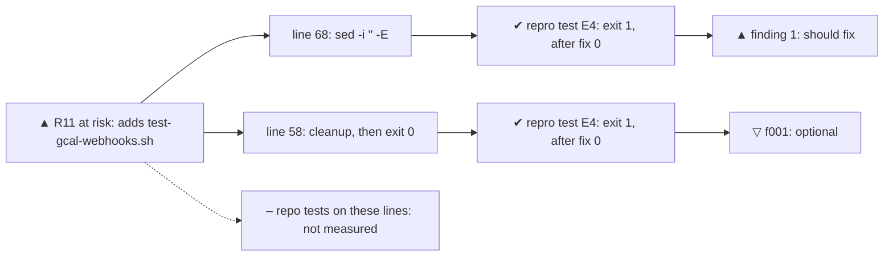
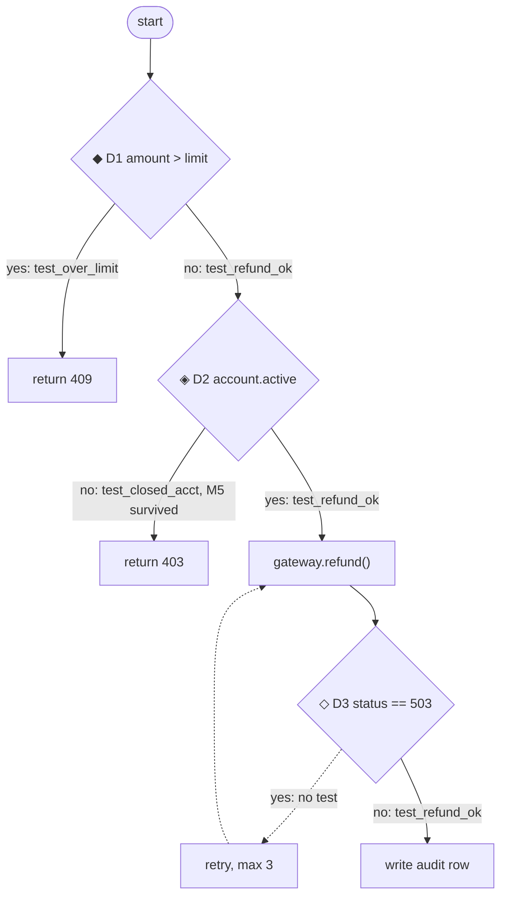
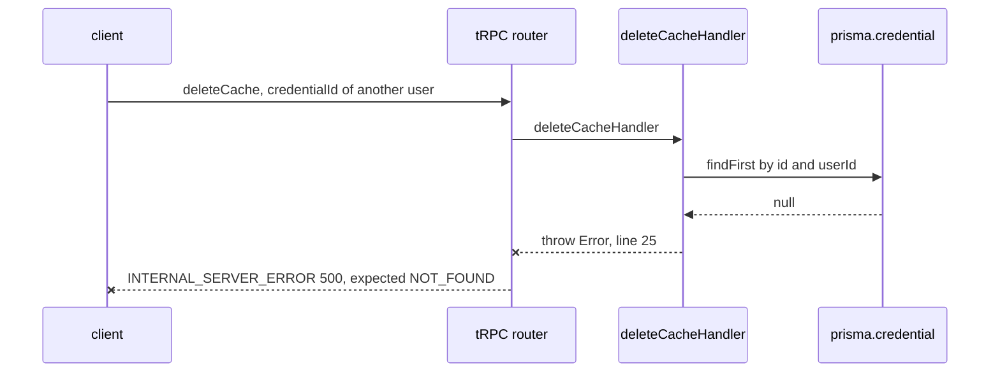
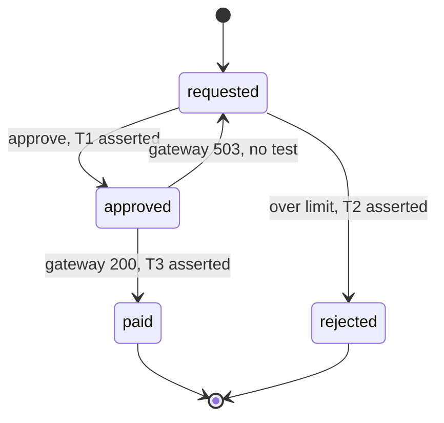

# Report components and diagrams for arbiter: research (2026-11-26, prefix RM)

Scope: (1) how an agent should present structured results to a human in GitHub markdown and HTML, (2) the five
markup components arbiter should rely on, (3) which UML or UML-like diagrams earn a place and at what size.
This file adds to [research-report-cognition.md](research-report-cognition.md) (RC, F),
[research-report-prior-art.md](research-report-prior-art.md) (RP, P) and
[research-report-render-stack.md](research-report-render-stack.md) (RS); it repeats none of them. The design that
uses it is [research-report-ux.md](research-report-ux.md). How the components behave per reporting situation (final
result, progress, decision, failure, handoff, research answer, change summary, alert) is in
[research-report-situations.md](research-report-situations.md) (RA, A); §3.6 gives the result. Visual proof:
[mockups/report-calcom.html](mockups/report-calcom.html) and [mockups/report-calcom.md](mockups/report-calcom.md).

Tags: `[unverified]` = source not opened or not confirmed. `[INFERENCE]` = my deduction. Strength: **strong** =
meta-analysis or replicated experiments; **moderate** = single controlled study or large field data; **weak** =
small or one-off; **opinion** = guidance with no experiment; **normative** = standard or official platform doc.
Keys: RM1–RM58 rich text, RM60+ diagrams. Findings: M1–M31 rich text, U1+ diagrams.

Re-checked by the author against the page (text found in the source):

| Pass | Keys | Result |
|---|---|---|
| first, 2026-11-26 | RM1, RM42, RM46, RM47, RM55 | hold |
| second, 2026-11-26 | RM1 (alert limits), RM10 (65,536), RM14 (alert in `<details>`), RM16, RM21, RM23, RM25, RM56 (n = 22), RM61 (30 to 60 elements), RM86 (20 vertices, n = 36); RC2, RC4, RC8, RC20, RC23, RC43, RC45, RC48, RP46, RP47 | hold |
| second | RM20 | the quote "Readers may overlook them" is not on the page; the page says readers "skip elements on the page, including notices". Fixed in row 3 of §2.2. |
| second | RM62 | the extracted PDF text shows "x = 44.5" on the size axis of Fig. 7; the flaw thresholds (0.5 per element, 15 to 20) could not be re-found in the garbled text. U3 and §2.5 now say so. |
| second | RC20 (used by UX rule E1) | the 42% is the concise version (task time 359 → 209 s); errors 0.82 → 0.10 is the combined version. The UX file mixed the two; fixed there. |
| second | RP47 (UX rule E11) | 43.88% vs 13.89% is the share of comments whose file was modified afterwards (hunk-level vs file-level tools), a proxy for "acted on". Wording softened in the UX file. |

Everything else in §1 rests on the first pass's reading or on earlier agents, as marked per row.

## 1. Sources

### 1.1 Rich-text presentation

| Key | Source | URL |
|---|---|---|
| RM1 | GitHub Docs: Basic writing and formatting syntax (alerts, footnotes, task lists, colour models, emoji, `<sub>/<sup>/<ins>`, `<kbd>` in use) | https://docs.github.com/en/get-started/writing-on-github/getting-started-with-writing-and-formatting-on-github/basic-writing-and-formatting-syntax |
| RM2 | GitHub Docs: Organizing information with collapsed sections (`<details>`, `<summary>`, `open`) | https://docs.github.com/en/get-started/writing-on-github/working-with-advanced-formatting/organizing-information-with-collapsed-sections |
| RM3 | GitHub Docs: Organizing information with tables | https://docs.github.com/en/get-started/writing-on-github/working-with-advanced-formatting/organizing-information-with-tables |
| RM4 | GitHub Docs: Creating a permanent link to a code snippet | https://docs.github.com/en/get-started/writing-on-github/working-with-advanced-formatting/creating-a-permanent-link-to-a-code-snippet |
| RM5 | GitHub Docs: About tasklists (tasklist *blocks* retired; replaced by sub-issues) | https://docs.github.com/en/get-started/writing-on-github/working-with-advanced-formatting/about-tasklists |
| RM6 | GFM spec: "Disallowed Raw HTML (extension)" (tagfilter) | https://github.github.com/gfm/ |
| RM7 | github/markup README (pipeline: convert, sanitise, highlight, filters) | https://github.com/github/markup/blob/master/README.md |
| RM8 | html-pipeline v2.14.3 `SanitizationFilter` allow-list (open-source snapshot of GitHub's sanitiser; not guaranteed to equal production today) | https://github.com/gjtorikian/html-pipeline/blob/v2.14.3/lib/html/pipeline/sanitization_filter.rb |
| RM9 | GitHub community #16925: Alerts announcement, update log and comments | https://github.com/orgs/community/discussions/16925 |
| RM10 | GitHub community #27190: max comment body length (staff answer) | https://github.com/orgs/community/discussions/27190 |
| RM11 | GitHub community #2822: mobile app does not support `<details>` | https://github.com/community/community/discussions/2822 |
| RM12 | GitHub community #210609 (2026-10-18) and #204374: Mermaid not rendered in GitHub Mobile | https://github.com/orgs/community/discussions/210609 ; https://github.com/orgs/community/discussions/204374 |
| RM13 | GitHub Blog (2012, updated 2024): Notification Email Improvements | https://github.blog/news-insights/the-library/notification-email-improvements/ |
| RM14 | markdown.land: GitHub alerts edge cases run through the Markdown API, Oct 2026 (secondary, tested) | https://markdown.land/markdown-alerts |
| RM15 | GitLab Docs: GLFM (alerts since 17.10, description lists, colour chips) | https://docs.gitlab.com/user/markdown |
| RM16 | Microsoft Writing Style Guide: Tables | https://learn.microsoft.com/en-us/style-guide/scannable-content/tables |
| RM17 | Microsoft Writing Style Guide: Lists | https://learn.microsoft.com/en-us/style-guide/scannable-content/lists |
| RM18 | Google developer documentation style guide: Tables | https://developers.google.com/style/tables |
| RM19 | Google developer documentation style guide: Lists (list or table; description lists) | https://developers.google.com/style/lists |
| RM20 | Google developer documentation style guide: Notes, cautions, warnings, and other notices | https://developers.google.com/style/notices |
| RM21 | GOV.UK Design System: Details | https://design-system.service.gov.uk/components/details/ |
| RM22 | GOV.UK Design System: Accordion | https://design-system.service.gov.uk/components/accordion/ |
| RM23 | GOV.UK Design System: Tag | https://design-system.service.gov.uk/components/tag/ |
| RM24 | GOV.UK Design System: Warning text | https://design-system.service.gov.uk/components/warning-text/ |
| RM25 | GOV.UK content design guidance: Tables | https://www.gov.uk/guidance/content-design/tables |
| RM26 | GOV.UK Design System: Table; Summary list (`<dl>` based) | https://design-system.service.gov.uk/components/table/ ; https://design-system.service.gov.uk/components/summary-list/ |
| RM27 | NN/g (Wang, 2023): Accordions on Desktop: When and How to Use | https://www.nngroup.com/articles/accordions-on-desktop/ |
| RM28 | NN/g (Laubheimer, 2016): Cards: UI-Component Definition | https://www.nngroup.com/articles/cards-component/ |
| RM29 | NN/g: Data Tables: Four Major User Tasks | https://www.nngroup.com/articles/data-tables/ |
| RM30 | NN/g: Comparison Tables | https://www.nngroup.com/articles/comparison-tables/ |
| RM31 | NN/g: Indicators, Validations, and Notifications | https://www.nngroup.com/articles/indicators-validations-notifications/ |
| RM32 | NN/g (Rosala, Kenderova, Kohler, 2026-04-17): Less Chat, More Answer | https://www.nngroup.com/articles/less-chat-more-answer/ |
| RM33 | W3C WAI: Tables Tutorial | https://www.w3.org/WAI/tutorials/tables/ |
| RM34 | W3C: Technique ARIA22 (`role="status"`); Understanding SC 4.1.3 Status Messages | https://www.w3.org/WAI/WCAG22/Techniques/aria/ARIA22 ; https://www.w3.org/WAI/WCAG22/Understanding/status-messages.html |
| RM35 | W3C: Technique ARIA24 (`role="img"` for icon glyphs); Technique G182 (extra cue besides text colour) | https://www.w3.org/WAI/WCAG22/Techniques/aria/ARIA24 ; https://www.w3.org/WAI/WCAG22/Techniques/general/G182 |
| RM36 | Scott O'Hara (2022): The details and summary elements, again (screen-reader test matrix, find-in-page) | https://www.scottohara.me/blog/2022/09/12/details-summary.html |
| RM37 | Adrian Roselli (2025): Updated Brief Note on Description List Support | https://adrianroselli.com/2025/01/updated-brief-note-on-description-list-support.html |
| RM38 | MDN: `<details>` (`name` attribute = exclusive group) | https://developer.mozilla.org/en-US/docs/Web/HTML/Reference/Elements/details |
| RM39 | Anthropic: Claude prompting best practices (formatting control, "minimize markdown" sample and its caveat) | https://platform.claude.com/docs/en/build-with-claude/prompt-engineering/claude-prompting-best-practices |
| RM40 | Anthropic: published system prompt, Claude Haiku 4.5 (`<tone_and_formatting>`) | https://platform.claude.com/docs/en/release-notes/system-prompts/claude-haiku-4-5 |
| RM41 | OpenAI Model Spec 2025-12-18 ("Be clear and direct", "Use Markdown with LaTeX extensions") | https://model-spec.openai.com/2025-12-18.html |
| RM42 | Leviathan et al. (Google): Generative UI: LLMs are Effective UI Generators (project page 2025; arXiv 2604.09577) | https://arxiv.org/html/2604.09577 ; https://generativeui.github.io/ |
| RM43 | What's In My Human Feedback? (WIMHF), arXiv 2510.26202 | https://arxiv.org/html/2510.26202v1 |
| RM44 | MDEval: Markdown Awareness in LLMs, arXiv 2501.15000 | https://arxiv.org/abs/2501.15000 |
| RM45 | "AI Should Be More Human, Not More Complex" (Otus), arXiv 2508.04713 (abstract only; vendor-authored) | https://arxiv.org/abs/2508.04713 |
| RM46 | Brick et al. (2020). Risk communication in tables versus text: registered report RCT on fact boxes. *R Soc Open Sci* | https://pmc.ncbi.nlm.nih.gov/articles/PMC7137953/ |
| RM47 | Schwartz, Woloshin, Welch (2009). Using a drug facts box: two randomized trials. *Ann Intern Med* 150(8) (PubMed abstract) | https://pubmed.ncbi.nlm.nih.gov/19221371/ |
| RM48 | Cook & Teo (2011). Communicability of Graphical Alternatives to Tabular Displays of Statistical Simulation Studies. *PLoS One* | https://pmc.ncbi.nlm.nih.gov/articles/PMC3223202/ |
| RM49 | Wright (1977). Presenting technical information: a survey of research findings. *Instr Sci* 6 (abstract only) | https://link.springer.com/article/10.1007/BF00121082 |
| RM50 | Information Mapping: effects of text features and reader characteristics (2007). *Information Design Journal* 15(1) (abstract only) | https://www.benjamins.com/catalog/idj.15.1.10pai |
| RM51 | Kools, Ruiter, van de Wiel, Kok (2008). Headings in Information Mapping and search speed. *J Inf Sci* 34(6) (abstract only) | https://cris.maastrichtuniversity.nl/en/publications/the-effects-of-headings-in-information-mapping-on-search-speed-an |
| RM52 | OASIS DITA 1.3: Technical content document types | https://docs.oasis-open.org/dita/dita/v1.3/os/part3-all-inclusive/archSpec/technicalContent/dita-technicalContent-InformationTypes.html |
| RM53 | Haynes et al. (2009). A surgical safety checklist. *NEJM* 360 (PubMed abstract) | https://pubmed.ncbi.nlm.nih.gov/19144931/ |
| RM54 | Gonçalves, Fregnan, Baum, Schneider, Bacchelli (2022). Do explicit review strategies improve code review performance? *EMSE* 27 (abstract) | https://link.springer.com/article/10.1007/s10664-022-10123-8 |
| RM55 | Braz et al. (2022). Less is More: Supporting Developers in Vulnerability Detection during Code Review, arXiv 2202.04586 | https://arxiv.org/abs/2202.04586 |
| RM56 | Kirwan et al. (2020). Repetition of Computer Security Warnings … Functional MRI. *Front Psychol* 11 | https://www.frontiersin.org/journals/psychology/articles/10.3389/fpsyg.2020.528079/full |
| RM57 | Ruchikachorn & Rattanawicha (2018). An Eye-Tracking Study on Sparklines within Textual Context. EuroVis poster | https://puripant.github.io/research/sparklines-preprint.pdf |
| RM58 | Goffin, Willett, Bezerianos, Isenberg (2015). Effect of Word-Scale Visualizations on Reading Behavior. CHI EA (poster text) | https://inria.hal.science/hal-01127995/document |

### 1.2 Diagrams, UML and Mermaid

| Key | Source | URL |
|---|---|---|
| RM60 | Störrle (2011). On the impact of layout quality to understanding UML diagrams. VL/HCC | https://backend.orbit.dtu.dk/ws/portalfiles/portal/6282242/PID1910517.pdf |
| RM61 | Störrle (2016). On the impact of size to the understanding of UML diagrams. SoSyM (journal version of the 2014 "Size matters" paper) | https://backend.orbit.dtu.dk/ws/files/127241189/VL_4d2_Size.pdf |
| RM62 | Störrle (2016). Diagram size vs. layout flaws. ESEM | https://backend.orbit.dtu.dk/ws/portalfiles/portal/132539081/a31_storrle.pdf |
| RM63 | Störrle (2014). The Good, the Bad, and the Ugly: UML diagram layout matters (talk slides) | https://www.pst.ifi.lmu.de/~stoerrle/talks/Good_Bad_Ugly-LayoutMatters.pdf |
| RM64 | Purchase, McGill, Colpoys, Carrington (2001). Graph drawing aesthetics and the comprehension of UML class diagrams | https://courses.ischool.berkeley.edu/i247/f05/readings/Purchase_UML_OzIV01.pdf |
| RM65 | Purchase, Colpoys, McGill, Carrington (2002). UML collaboration diagram syntax: an empirical study of comprehension. VISSOFT (abstract) | https://research.monash.edu/en/publications/uml-collaboration-diagram-syntax-an-empirical-study-of-comprehens/ |
| RM66 | Purchase (1997). Which aesthetic has the greatest effect on human understanding? Graph Drawing (abstract) | https://link.springer.com/chapter/10.1007/3-540-63938-1_67 |
| RM67 | Kutar, Britton, Barker (2002). A comparison of empirical study and cognitive dimensions analysis in the evaluation of UML diagrams. PPIG | https://ppig.org/files/2002-PPIG-14th-kutar.pdf |
| RM68 | Britton, Kutar et al. (2002). An empirical study of user preference and performance with UML diagrams. HCC | https://uhra.herts.ac.uk/id/eprint/18231/1/901780.pdf |
| RM69 | Otero & Dolado (2002). An initial experimental assessment of the dynamic modelling in UML. EMSE 7 (abstract) | https://link.springer.com/article/10.1023/A:1014819010099 |
| RM70 | Glezer, Last, Nahmani, Shoval (2005). Experimental comparison of sequence and collaboration diagrams in different application domains (abstract) | https://cris.ariel.ac.il/en/publications/experimental-comparison-of-sequence-and-collaboration-diagrams-in-3/ |
| RM71 | Arisholm, Briand, Hove, Labiche (2006). The impact of UML documentation on software maintenance. IEEE TSE 32(6) (abstract; closes RC54 `[unverified]`) | https://ieeexplore.ieee.org/document/1650213 |
| RM72 | Dzidek, Arisholm, Briand (2008). A realistic empirical evaluation of the costs and benefits of UML in software maintenance. IEEE TSE 34(3) (abstract) + Dzidek PhD thesis (full text) | https://ui.adsabs.harvard.edu/abs/2008ITSEn..34..407D/abstract ; https://cms.simula.no/sites/default/files/publications/Simula.SE.581.pdf |
| RM73 | Budgen, Burn, Brereton, Kitchenham, Pretorius (2011). Empirical evidence about the UML: a systematic literature review. SPE 41 (abstract) | https://ebse.webspace.durham.ac.uk/ebse-bibliography/empirical-evidence-about-the-uml-a-systematic-literature-review/ |
| RM74 | Fernández-Sáez, Genero, Caivano, Chaudron (2016). Does the level of detail of UML diagrams affect the maintainability of source code? EMSE 21 (abstract) | https://link.springer.com/article/10.1007/s10664-014-9354-4 |
| RM75 | Cruz-Lemus, Genero, Manso, Morasca, Piattini (2009). Assessing the understandability of UML statechart diagrams with composite states. EMSE 14 (abstract) | https://link.springer.com/article/10.1007/s10664-009-9106-z |
| RM76 | Cruz-Lemus, Genero, Piattini, Toval (2005). An empirical study of the nesting level of composite states within UML statechart diagrams (abstract) | https://link.springer.com/chapter/10.1007/11568346_3 |
| RM77 | Felderer & Herrmann (2019). Comprehensibility of system models during test design: UML activity diagrams vs state machines. SQJ 27 (open access) | https://link.springer.com/article/10.1007/s11219-018-9407-9 |
| RM78 | Birkmeier & Overhage (2010). Is BPMN really first choice? BPMN vs UML activity diagrams for business users. QoSA (abstract) | https://link.springer.com/chapter/10.1007/978-3-642-13821-8_10 |
| RM79 | Mendling, Reijers, van der Aalst (2010). Seven process modeling guidelines (7PMG). IST 52(2) | https://www.vdaalst.com/publications/p574.pdf |
| RM80 | Blackwell, Whitley, Good, Petre (2001). Cognitive factors in programming with diagrams (reviews Scanlan 1989, Curtis 1989) | https://www.cl.cam.ac.uk/~afb21/publications/aire.pdf |
| RM81 | Petre (2013). UML in practice. ICSE. Read through the Never Work in Theory summary (primary page returned 403) | https://neverworkintheory.org/2013/06/13/uml-in-practice-2.html |
| RM82 | Baltes & Diehl (2014). Sketches and diagrams in practice. FSE (abstract) | https://arxiv.org/abs/1706.09172 |
| RM83 | Moody (2009). The "Physics" of Notations. IEEE TSE 35(6) (abstract) | https://ieeexplore.ieee.org/document/5353439 |
| RM84 | Moody & van Hillegersberg (2008). Evaluating the visual syntax of UML. SLE (abstract) | https://link.springer.com/chapter/10.1007/978-3-642-00434-6_3 |
| RM85 | Slide summary of RM83 (secondary source, not by Moody) | https://pdfs.semanticscholar.org/fbc6/0c004d84d6ee55aaa02f34a823da4f898b2b.pdf |
| RM86 | Ghoniem, Fekete, Castagliola (2005). On the readability of graphs using node-link and matrix-based representations. Information Visualization 4(2) | http://www-sop.inria.fr/orion/COGC/teams/INSITUghoniem-fivj05-final.pdf |
| RM87 | Yoghourdjian, Yang, Dwyer, Lawrence, Wybrow, Marriott (2020). Scalability of network visualisation from a cognitive load perspective. IEEE VIS/TVCG | https://arxiv.org/abs/2008.07944 |
| RM88 | Yoghourdjian et al. (2018). Exploring the limits of complexity: a survey of empirical studies on graph visualisation (abstract) | https://arxiv.org/abs/1809.00270 |
| RM89 | Okoe, Jianu, Kobourov (2018). Node-link or adjacency matrices: old question, new insights. TVCG | https://www2.cs.arizona.edu/~kobourov/NL-AM-TVCG18.pdf |
| RM90 | Bennett, Myers, Storey et al. (2008). A survey and evaluation of tool features for understanding reverse-engineered sequence diagrams. JSME 20 | https://turingmachine.org/~dmg/papers/dmg2008_jsme_traces.pdf |
| RM91 | Gyawali, Hayatpur, Polikarpova (2026). CG-Diff: organizing code changes around call graphs | https://arxiv.org/abs/2609.32057 |
| RM92 | C4 model official site: system context, container, component, code, notation pages | https://c4model.com/diagrams/system-context ; https://c4model.com/diagrams/container ; https://c4model.com/diagrams/component ; https://c4model.com/diagrams/code ; https://c4model.com/diagrams/notation |
| RM93 | GitHub Blog (2022). Include diagrams in your Markdown files with Mermaid ("How it works") | https://github.blog/developer-skills/github/include-diagrams-markdown-files-mermaid/ |
| RM94 | GitHub community #70672: Update mermaid to latest version (user-reported deployed versions 2024-2026) | https://github.com/orgs/community/discussions/70672 |
| RM95 | GitHub community #144793 (Android app shows code) ; mermaid-js issue #5246 (iOS app shows code) | https://github.com/orgs/community/discussions/144793 ; https://github.com/mermaid-js/mermaid/issues/5246 |
| RM96 | GitHub community #194348: Mermaid rendering still broken in dark mode (2026-04-29) | https://github.com/orgs/community/discussions/194348 |
| RM97 | GitHub community #204537: Mermaid `<br>` tags not recognised (2026-08-10, fixed 2026-08-14) | https://github.com/orgs/community/discussions/204537 |
| RM98 | Mermaid docs sidebar source (diagram list) and beta list, `develop` branch at v12.3.0 | https://raw.githubusercontent.com/mermaid-js/mermaid/develop/packages/mermaid/src/docs/.vitepress/config.ts ; https://raw.githubusercontent.com/mermaid-js/mermaid/develop/packages/mermaid/src/docs/.vitepress/betaDiagrams.ts |
| RM99 | Mermaid config schema (`maxTextSize`, `maxEdges`, `secure`, `theme`) | https://raw.githubusercontent.com/mermaid-js/mermaid/develop/packages/mermaid/src/schemas/config.schema.yaml |
| RM100 | Mermaid docs: Accessibility options | https://mermaid.js.org/config/accessibility.html |
| RM101 | Mermaid docs: Directives ; Theming | https://mermaid.js.org/config/directives.html ; https://mermaid.js.org/config/theming.html |
| RM102 | Mermaid syntax docs: C4 (current and tag `mermaid@11.16.1`), architecture, requirementDiagram, block, stateDiagram, usecase, flowchart, sequenceDiagram, classDiagram, entityRelationshipDiagram | https://mermaid.js.org/syntax/c4.html ; https://raw.githubusercontent.com/mermaid-js/mermaid/mermaid%4011.16.1/docs/syntax/c4.md ; https://mermaid.js.org/syntax/architecture.html ; https://mermaid.js.org/syntax/requirementDiagram.html ; https://mermaid.js.org/syntax/block.html ; https://mermaid.js.org/syntax/stateDiagram.html ; https://mermaid.js.org/syntax/usecase.html |
| RM103 | W3C WAI Images Tutorial: Complex images | https://www.w3.org/WAI/tutorials/images/complex/ |
| RM104 | W3C ACT rule 7d6734: SVG element with explicit role has non-empty accessible name | https://www.w3.org/WAI/standards-guidelines/act/rules/7d6734/proposed/ |

## 2. Findings

### 2.1 How an agent should present structured results

| # | Finding (with numbers: n, effect, year) | Keys | Strength |
|---|---|---|---|
| M1 | Tables beat the same content as text. Registered-report RCT, n = 2,305 (UK, 2020): fact-box tables gave better comprehension (**d = 0.39**) and slightly better recall at 6 weeks (d = 0.12), at every numeracy and education level. | RM46 | strong |
| M2 | Drug facts box (a table) vs the usual text summary, two RCTs, n = 231 and 219 (2009): 70% vs 8% judged the better drug correctly; 72% vs 9% quantified the benefit correctly; 68% vs 31% chose the superior drug. The control text was a real ad summary, so part of the gain is content, not only format. | RM47 | strong |
| M3 | Tables are not best for trends or large grids. Randomised crossover with statisticians (2011): answers from graphs came **27 s faster** on average (95% interval 14–47 s) than from large result tables; less experienced readers took about twice as long with tables. | RM48 | moderate |
| M4 | Review of presentation research (1977): no single best format; tables, flow charts and headings each win in specific circumstances (reference lookup vs full reading). | RM49 | moderate (review, abstract only) |
| M5 | Information Mapping (chunk + label + typed blocks): three experiments (2007) found readers of a *long* text worked more effectively and efficiently with the mapped version; an earlier study on a *short* text found no effect. Adding only the format features (labels, layout) to unchanged text raised efficiency and appreciation, not effectiveness. | RM50 | moderate |
| M6 | Headings placed per Information Mapping raised search speed in a health text (2008). Exact numbers not read. | RM51 | moderate (abstract only) |
| M7 | DITA fixes the information type per topic: concept, task, reference, troubleshooting, glossary. One topic carries one type and has a short description first. | RM52 | normative |
| M8 | Chatbot answers, qualitative study (n = 9 users, 8 site chatbots, 2026): a viewport-filling paragraph made users stop reading; users asked for bullets, links and pictures. Guidance: answer first, paragraphs of at most 2–3 sentences, lists / bold / headers / white space when a long answer is unavoidable, and no pleasantries. "A longer answer was not a better answer." | RM32 | weak (small n) |
| M9 | Format preference is real but split. In Chat Arena preference data, "paragraphs instead of bullet points" lowered win rate by 48%; the same feature was the most subjective preference in the data (a minority prefers paragraphs). | RM43 | moderate (large field data, model-inferred features) |
| M10 | Generated UI beats markdown, and markdown beats plain text. Human raters on 100 sampled LMArena prompts (8 excluded), 2 raters each, pre-cached results so speed is ignored. ELO: human-expert page 1800.3, Generative UI 1736.2, markdown 1437.7, top search result 1352.2, plain text 1173.7. Generative UI was preferred over markdown **82.8%** of the time (90.5% on information-seeking prompts) and tied experts at 50.0%. Preference only; comprehension and decision accuracy were not measured. | RM42 | moderate (preference, vendor study) |
| M11 | Structured markdown output correlates with human readability ratings (MDEval "Markdown Awareness": Spearman 0.791 with human judgement, 20K instances). | RM44 | weak (benchmark, not a user study) |
| M12 | Vendor defaults push *against* heavy formatting in chat. Anthropic's published system prompt: "avoids over-formatting … bold emphasis, headers, lists, and bullet points"; use lists only when asked or when the answer is multifaceted; each bullet at least 1–2 sentences; no bullets in reports and explanations. Anthropic's prompting guide also warns that a "minimize markdown" block "can suppress structure the content needs". | RM39, RM40 | opinion (vendor) |
| M13 | OpenAI Model Spec: "Formatting (such as bold, italics, or bulleted lists) should be used judiciously to aid the user in scanning the response". Markdown tables, headings and fenced code are allowed; responses should be "lucid, succinct, and well-organized". | RM41 | opinion (vendor) |
| M14 | `[INFERENCE]` M12–M13 govern conversational answers. A review report is reference material that is scanned and compared, so M1–M2 and the style guides (M15–M17) apply instead. The shared rule is the same: each format must aid scanning; never format for decoration. | RM39–RM41, RM46 | inference |
| M15 | List rules. Microsoft: 2 to 7 items, each short, parallel structure, numbered only when order matters. Google: tables for items with several properties, lists for one-dimensional sets; a one-column table must become a list. | RM17, RM19, RM18 | opinion (guidance) |
| M16 | Table rules. Microsoft: do not use a table for a plain list; row identifier in the leftmost column; parallel entries; "limit the number of columns and keep the text in each cell brief—ideally one line". GOV.UK: at least 2 columns × 3 rows; a desktop shows about 4–5 columns and 10 rows without scrolling; no merged or split cells; write "no data" in place of empty cells; right-align numbers to compare. Google: introduce every table with a full sentence because not all screen readers pre-announce tables. | RM16, RM25, RM18 | opinion (guidance) |
| M17 | Status wording. GOV.UK Tag: status only, never interactive; use adjectives, not verbs; start with the fewest statuses ("the more you add, the harder it is for users to remember them"); one status can be enough because no tag means the default state; never colour alone. | RM23 | opinion (guidance) |
| M18 | Horn's seven information types (procedure, process, concept, structure, classification, principle, fact) `[unverified: primary Horn paper not opened]`. | — | — |

### 2.2 Evidence per candidate component

| # | Component | Evidence for | Evidence against | Limits | Accessibility | Strength |
|---|---|---|---|---|---|---|
| 1 | Status badge / verdict line | Indicators are contextual, conditional and passive, and work best next to the item they describe (RM31). GOV.UK Tag exists only to show status (RM23). Prior: E2, E6, P1, P11. | More statuses are harder to remember (RM23). Verb labels look clickable (RM23). | Fewest statuses that work; adjective labels; same colour per status everywhere (RM23). GitHub strips `style`, so a badge is emoji/glyph + word, or an image (RM7, RM8). | Colour never alone (WCAG 1.4.1 via RM23; G182 in RM35). Give a glyph `role="img"` + `aria-label` in HTML (RM35; both attributes are on the RM8 allow-list). `role="status"` is for content that *updates* (live region), not a static verdict (RM34). | moderate (guidance + normative) |
| 2 | Table / matrix | d = 0.39 comprehension vs text, n = 2,305 (RM46); 70% vs 8% correct (RM47); adjacent cells compare without working-memory load (RM29); renders in GFM, GitLab and GitHub Mobile `[mobile unverified]` (RM3). | Graphs faster for large numeric grids, 27 s (RM48). Not for one-dimensional lists (RM16, RM18). Long cell text breaks scanning (RM16). | ≥ 2 cols × 3 rows; about 4–5 cols × 10 rows per screen (RM25); ≤ 5 compared items (RM30); cell text one line (RM16); no merged cells (RM25); GFM needs a blank line before the table and `\|` to escape pipes (RM3). | `<th>` plus `scope` for two-header tables; avoid irregular headers (RM33). GFM pipe tables give column headers only, so a row header needs raw HTML `<th scope="row">` (`scope` is on the RM8 allow-list). Sentence before the table (RM18). | strong |
| 3 | Callout / admonition | Signalling works when sparse (prior F4). Five GitHub types with icon + colour + word, so not colour-only (RM1). | Readers "skip elements on the page, including notices, that are outside their focus of interest"; several on a page "begin to lose their visual distinctiveness", worst two in a row (RM20). Repeated warnings give neural repetition suppression, n = 22 fMRI (RM56); prior F44 shows −30% acceptance per extra reminder. No study on documentation callouts found. | GitHub's own rule: "limit them to one or two per article", never consecutive, never nested (RM1). Do not render inside `<details>`, list items or other blockquotes; marker must be alone on its line; no custom title (RM14, RM9). | Type word is rendered as text on GitHub. Outside GitHub/GitLab/Obsidian it degrades to a blockquote that shows literal `[!NOTE]` (RM14). | moderate (against overuse); opinion (for) |
| 4 | Collapsible `<details>` | Makes a page easier to scan when only some users need the content (RM21). Lets users jump to one section without reading the rest (RM27). Prior: E4, P14. | Lower content visibility and extra interaction cost; users may not notice hidden content; hurts when several sections are needed together; printing needs each section opened (RM27). "Do not use … to hide information that the majority of your users will need" (RM21, RM22). GitHub Mobile showed summary and body both expanded (RM11). | One level; details for content "not as important" (RM21); nested accordions lose users (RM27); prior F22 says ≤ 2 levels. Put the verdict and any must-read item outside. `open` attribute shows it expanded by default (RM2). | Chromium find-in-page opens closed `<details>`; Firefox and Safari did not in 2022 (RM36). `<summary>` role is announced inconsistently (button / summary / disclosure triangle / none) across screen readers; keep the default triangle because some pairings announce state only through it; headings inside `<summary>` can lose semantics (RM36). `name` attribute makes an exclusive group, which blocks side-by-side reading (RM38, RM27). | moderate |
| 5 | Definition list | Google lists it as a standard list type for term + description (RM19). GOV.UK Summary list uses `<dl>` for key–value facts (RM26). `dl/dt/dd` are on GitHub's allow-list (RM8); GLFM has native syntax (RM15). | No GFM markdown syntax, so raw HTML is needed on GitHub; GitHub styling of `<dl>` not confirmed. No comparison study found. | Key–value facts about one thing; use a table once there are 2+ things to compare `[INFERENCE from RM19, RM29]`. | Support "generally good", VoiceOver the outlier; announcements differ by screen reader (RM37). | opinion |
| 6 | Checklist / task list | Surgical 19-item checklist, before/after at 8 hospitals (n = 3,733 → 3,955, 2009): deaths 1.5% → 0.8%, complications 11.0% → 7.0% (RM53). Code review: checklist helped novices' effectiveness and efficiency on a complex task and can lower cognitive load (RM54). GFM renders `- [ ]` / `- [x]` (RM1). | Not randomised (RM53). Code review: "did not identify a strong relationship between the guidance provided and code review performance" (RM54). Security review, n = 150: telling reviewers to focus on security gave 8× detection odds; adding a checklist, even a tailored one, gave no significant further gain (RM55). | Short and specific to the change `[INFERENCE from RM54, RM55]`; RM53 used 19 items for a whole operation. In GitHub comments the boxes are interactive for users with edit rights; tasklist *blocks* are retired (RM5). | Rendered as checkbox inputs; pair each with a text state when the state is the message `[INFERENCE]`. | moderate (mixed) |
| 7 | Diagram | Prior: F9, F47, F49, E12, P21. New here: generated visual layouts preferred over markdown 82.8% (RM42). | GitHub Mobile shows Mermaid source, not the diagram (RM12, Oct 2026). Inline `<svg>` is not on the allow-list; `` accepts only http/https/relative `src`, so no `data:` URIs (RM8). | Mermaid fence, or an image hosted at an http(s) URL. Always keep a text fallback for mobile and email `[INFERENCE]`. | `role="img"` + label for a graphic (RM35); a text equivalent beside it. | weak (new evidence); see prior reports |
| 8 | Inline code anchor (`file:line`) | A commit-SHA permalink with a line range pasted in a comment renders as an embedded snippet (RM4). Prior: E3, E11. | Snippet embed works only in comments of the *same* repository; elsewhere it is a plain URL; never in `.md` files (RM4). | Needs `blob/<sha>/path#Lx-Ly`; markdown files need `?plain=1` (RM4). Each embedded snippet adds height `[INFERENCE]`. | Link text must name the target (`path:line`), not "here" `[INFERENCE]`. | normative (platform) |
| 9 | Sparkline / inline bar | Eye tracking, n = 296 (2018): sparklines in text did not distract; 3.19% of reading time (RM57). Placement (above / right / overlay) made no practical difference to accuracy or time (RM58, small poster study). Prior: F11, F15. | Dwell time on sparklines did not correlate with understanding (RM57): little proof they add comprehension. No inline SVG or `style` on GitHub (RM8). | On GitHub only Unicode blocks (`▁▃▇`, `████░░`) or an image. Always print the number next to it `[INFERENCE from RM57]`. | Screen readers read block glyphs one by one or skip them; wrap in `role="img"` with a label in HTML, and keep the number as text (RM35) `[INFERENCE]`. | weak |
| 10 | Cards | Good for browsing heterogeneous items; a common region groups mixed content (RM28). | "Card layouts are less scannable than lists"; rank is de-emphasised; they take more space; "poor choice when users need to compare" (RM28). Cards force eyes to re-orient per item; tables do not (RM29). No card primitive in GFM. | HTML report only, for few unlike items; never for ranked findings or comparison (RM28). | Plain headings + lists inside; reading order must equal DOM order `[INFERENCE]`. | moderate (against, for arbiter's ranked findings) |

### 2.3 GitHub platform facts

| # | Finding | Keys | Strength |
|---|---|---|---|
| M19 | Rendered in issue/PR comments: pipe tables (with inline code, links, bold inside cells); alerts; `<details>/<summary>` with markdown inside; task lists; footnotes `[^1]`; emoji shortcodes `:name:`; `<sub>`, `<sup>`, `<ins>`; HTML comments hidden. | RM1, RM2, RM3 | normative |
| M20 | Alerts: exactly five types, `NOTE`, `TIP`, `IMPORTANT`, `WARNING`, `CAUTION`. Docs: use "only when they are crucial", "one or two per article", not consecutive, "cannot be nested within other elements". | RM1 | normative |
| M21 | Alert edge cases (tested Oct 2026 by a third party; nesting confirmed by GitHub's update log and user reports): inside `<details>`, a list item or another blockquote the alert becomes a plain blockquote with the marker as text; text on the marker line, custom titles and unknown types (`[!DANGER]`) also fall back; case does not matter. | RM14, RM9 | moderate (secondary + platform thread) |
| M22 | Outside GitHub: GitLab (17.10+) and Obsidian read the same syntax; most other renderers, Jekyll/kramdown included, show a blockquote with literal `[!NOTE]`. | RM14, RM15 | moderate |
| M23 | Colour chips: a HEX, RGB or HSL value alone in backticks shows a colour dot, "only supported in issues, pull requests, and discussions"; no leading or trailing spaces. | RM1 | normative |
| M24 | Code permalinks expand to a snippet only in comments, and only in the repository the code belongs to. | RM4 | normative |
| M25 | Max body length: 65,536 characters (stored as a 262,144-byte MySQL mediumblob = 65,536 4-byte characters); same limit for UI and API, issue comments and PR bodies. Source is a GitHub staff forum answer (2020), not the docs. | RM10 | moderate |
| M26 | GFM spec filters only 9 tags (`title, textarea, style, xmp, iframe, noembed, noframes, script, plaintext`). GitHub.com then sanitises further: removes `script`, inline styles, `class` and `id`. | RM6, RM7 | normative |
| M27 | Allow-list in the open-source sanitiser (snapshot): elements include `table thead tbody tfoot tr td th caption`, `details summary`, `dl dt dd`, `kbd sub sup ins del mark abbr`, `figure figcaption`, `div span`, `img`, `ruby`. Attributes include `align width height colspan rowspan scope headers open role aria-label aria-labelledby aria-describedby aria-hidden title`. **Not** allowed: `style`, `class`, `id`, `svg`, `iframe`. `img src` accepts only `http`, `https` and relative URLs, so `data:` URIs are dropped. | RM8 | moderate (snapshot, not live production config) |
| M28 | `<dl>` passes the sanitiser (M27) but GFM has no markdown syntax for it; GLFM does. How GitHub styles `<dl>` in comments was not confirmed. | RM8, RM15 | moderate |
| M29 | GitHub Mobile: Mermaid fences show raw source in the iOS/iPadOS app (reports Oct 2026). `<details>` was shown fully expanded in the app (older report; current state `[unverified]`). Alerts in Mobile were announced for Markdown *files* in Nov 2023; comments `[unverified]`. | RM12, RM11, RM9 | weak (user reports) |
| M30 | Email notifications are sent with HTML and plain-text parts, with markdown rendered (2012 post). `[INFERENCE]` Mermaid cannot render in email because it needs JavaScript; `<details>`, alerts and tables in notification email are `[unverified]`. | RM13 | weak |
| M31 | Task lists (`- [ ]`) remain supported markdown. The separate "tasklist blocks" feature is retired in favour of sub-issues. | RM1, RM5 | normative |

### 2.4 Diagram comprehension evidence

| # | Finding (with numbers: n, effect, year) | Keys | Strength |
|---|---|---|---|
| U1 | **Size is the strongest known factor.** Re-analysis of 3 experiments, n = 78, > 1,200 measurements, 36 diagrams (class, state machine, sequence), 2016. Score falls linearly with element count (intercept 7.21, slope −0.014 on a 0-10 score). Perceived clarity vs size: r beyond −0.7 for poor layouts. Author: size "matches or exceeds" other factors. | RM61 | moderate |
| U2 | **Recommended size: 30 to 60 diagram elements.** An element is any shape, line segment or label (4 shapes + 4 lines + 1 label = 9 elements). Real-world check: 810 class diagrams in the Gothenburg repository have median 39 elements, middle quartiles 22-59. | RM61 | moderate |
| U3 | **Replication, wider data:** 60 diagrams, 5 UML types, n = 156, about 14,000 data points, 2016. Size effect confirmed, "a little smaller". Layout flaws (crossings, bends, overlaps, misalignment) have "the same effect, but much more so", and depend less on expertise or diagram type. Guidelines: flaw rate ≤ 0.5 per element, ≤ 15-20 flaws, fix flaws before removing elements `[first pass; not re-found in the second]`. Fig. 7 marks 44.5 elements on the size axis. | RM62 | moderate |
| U4 | **Good layout as a bundle works; single aesthetics barely do.** 3 experiments, n = 78 (43 novices, 34 advanced), class/use-case/activity diagrams, 2011. Good vs bad layout: correct answers +6.7% (novices) and +6.8% (advanced), time per correct answer −17.4%, rated clarity +28.2%. Good = join similar edges, cluster similar elements, orthogonal arrangement, elements placed in flow. Bad = crossings, bends, overlaps, varying colours/sizes/text direction. | RM60, RM63 | moderate |
| U5 | Novices lose more than experts as size grows; "the capacity to cope with size defines expertise", worse with poor layout. Top-expertise group shows near-zero correlations (r −0.07 to −0.17, not significant). | RM62, RM63 | moderate |
| U6 | Class-diagram aesthetics tested one at a time (bends, node distribution, edge variation, flow, orthogonality, edge length, symmetry; crossings held at 0), 2 experiments, 2001: few significant results. Authors: "tempting to say that none of the aesthetics really matter (apart from bends, which only matters a little)". They propose **semantic grouping** of related objects as the missing factor. n not captured. | RM64 | weak |
| U7 | Abstract graphs, 1997, 5 aesthetics: "reducing the number of edge crosses is by far the most important aesthetic"; bends and symmetry have a lesser effect. | RM66 | moderate |
| U8 | Collaboration-diagram notation variants (5 notations × 2 variants), 2002: readers prefer "the more concise notational variants"; intuition about complexity holds for matching, not for error finding. | RM65 | weak |
| U9 | **Sequence vs communication: no robust winner.** n = 124 first-years (2002): no difference (p = 0.72); scenario mattered (p < 0.001). n = 18 (2002): sequence most comprehensible, communication degrades as the document gets complex. 2005: communication easier for real-time systems, no difference for MIS. Stated preference did not predict performance. | RM67, RM68, RM69, RM70 | moderate (mixed) |
| U10 | **UML documentation helps correctness, costs time.** 2006, students, Oslo + Ottawa: for complex tasks better functional correctness and design quality, "no saving of time"; counting diagram updates, the no-UML groups were 27% and 47.6% faster. 2008, n = 20 professionals, real system, 5 tasks: **+54% functional correctness (p = 0.03)**, +7% design quality (n.s.), +14% time (n.s., p = 0.35). | RM71, RM72 | moderate |
| U11 | Systematic review to end-2008: 49 empirical UML papers (metrics, comprehension, model quality, methods/tools, adoption). "Researchers tend to use the UML as a 'given'" and rarely test whether it works. | RM73 | strong (as a map), weak (as effect evidence) |
| U12 | **Level of detail:** 4 experiments, n = 81 students, 3 countries, 2016. No significant effect. Slight tendency: low detail better for modifying code, high detail for understanding. Participants preferred low detail and "minimized or avoided the use of UML diagrams" on small familiar systems. | RM74 | moderate (null) |
| U13 | **Statechart nesting:** 5 experiments + meta-analysis, 2009: results "cast doubts on the usefulness of composite states" for understanding and memorising. Nesting-depth experiment + replication, 2005: "not able to find an optimal use of nesting". | RM75, RM76 | moderate (null) |
| U14 | **Activity vs state machine:** n = 84 students, replicated, 2019. Activity diagrams are more comprehensible but produce more errors in manual test-case derivation. | RM77 | moderate |
| U15 | Activity diagram vs BPMN for business users, 2010: no significant difference in effectiveness, efficiency or satisfaction. No reason to prefer a special process notation. | RM78 | weak |
| U16 | Process models (EPC/BPMN corpus studies): > 50 elements → error probability above 50%; errors rise with node degree and with multiple start/end events. Guidelines: fewest elements, minimise arcs per element, one start and one end, structured splits/joins, avoid OR, verb-object labels, decompose > 50. | RM79 | moderate |
| U17 | **Flowchart vs text (Scanlan 1989, via review):** structured flowcharts beat pseudocode on time and accuracy for conditional logic, in simple and complex cases. No study shows a flowchart advantage across the whole programming task; the gain is for control flow with branches. | RM80 | moderate (secondary) |
| U18 | **What practitioners use:** 50 engineers interviewed, 2013: 35 no UML, 11 selective, 3 code generation, 1 retrofit, 0 wholehearted. Selective users: class 7, sequence 6, activity 6, state machine 3, use case 1. Use is informal and partial. | RM81 | moderate (secondary summary) |
| U19 | Survey n = 394, 2014: most sketches contain some UML elements but are informal; main purposes are designing, explaining, understanding; they relate to methods, classes or packages, "not to source code artifacts with a lower level of abstraction". | RM82 | moderate |
| U20 | **Physics of Notations:** UML visual syntax has "serious design flaws". Per the slide summary: UML fails graphic economy (people discriminate about 6 categories per visual variable; more needs a legend), uses shape almost alone (no colour), lacks summary/contextualisation diagrams; complexity limit stated as 7 ± 2 elements per diagram. | RM83, RM84, RM85 | opinion (theory-based analysis) |
| U21 | **Matrix vs node-link:** n = 36, graphs of 20/50/100 nodes × density 0.2/0.4/0.6, 2005. Above 20 nodes the matrix wins most tasks (about 30% more correct answers on larger graphs). Node-link wins only path finding, and wins everything on small graphs. | RM86 | moderate |
| U22 | Crowdsourced, 14 tasks, about 50 per condition, 2018: node-link better for topology/connectivity (more accurate in 5 of 10 tasks, less in 3); matrix better in 2 of 4 group/cluster tasks. | RM89 | moderate |
| U23 | Node-link ceiling: n = 22, 25-175 nodes, EEG + pupil, 2020. Shortest-path tasks break down above 50 nodes (dense) and 100 nodes (sparse). Global features (size, crossings) matter more than features of the path. Load rises, then drops when people give up. | RM87, RM88 | moderate |
| U24 | Reverse-engineered sequence diagrams: traces of 3,049-23,227 calls, depth 5-12; n = 6. Unusable without filtering, hiding and linked views; the package-linked view was rated most useful by 5 of 6. | RM90 | weak |
| U25 | **Diagrams in PR review (closest study):** 9,310 PRs, 77 Python projects, 2026. In 39.6% of PRs more than half the changed functions are connected by a call graph; median largest cluster = 5 functions, ≥ 10 in 26.8%. User study n = 7 (qualitative): call-graph view helped orient and navigate; repeated nodes disorient; changes outside functions are easy to miss. | RM91 | weak (user study), moderate (PR mining) |
| U26 | No controlled study found of auto-generated Mermaid diagrams in AI review bots (CodeRabbit-style sequence diagrams). Only vendor claims. | — | — |
| U27 | **C4 official guidance:** system context and container diagrams "recommended for all software development teams"; component: "No, only create component diagrams if you feel they add value"; code: "No". Every diagram needs a title with type and scope, a key/legend, typed elements with a short description. No empirical evaluation found. | RM92 | opinion |

### 2.5 Size limits and layout rules

| Quantity | Limit to apply | Basis | Keys | Strength |
|---|---|---|---|---|
| Total elements (shapes + line segments + labels) | target ≤ 45, hard stop 60 | recommended range 30-60, about 50 for the median modeler (RM61); 44.5 in the replication's figure (RM62) | RM61, RM62 | moderate |
| Nodes (boxes) | ≤ 12-15 with ≤ 20 edges `[INFERENCE: 15 boxes + 20 edges + 10 edge labels = 45 elements]` | derived from row above | RM61 | moderate |
| Node-link vs matrix switch | > 20 nodes → use a matrix/table unless the task is path following | n = 36 experiment | RM86, RM89 | moderate |
| Absolute node-link ceiling | 50 nodes dense, 100 sparse (path tasks fail) | n = 22 experiment | RM87 | moderate |
| Split rule | > 50 elements → decompose into linked sub-diagrams | error probability > 50% | RM79 | moderate |
| Layout flaws | ≤ 15-20 per diagram; ≤ 0.5 per element; remove flaws before removing elements | n = 156 re-analysis | RM62 | moderate |
| Edge crossings | 0 where possible; most harmful single aesthetic | 1997 experiment; 2020 global-feature result | RM66, RM87 | moderate |
| Bends | minor; accept bends to keep related nodes together | class-diagram experiments | RM64, RM66 | weak |
| Flow direction | one direction per diagram, nodes placed "in flow" | part of the good-layout bundle; alone not significant | RM60, RM64 | moderate (bundle) |
| Grouping | cluster related nodes, join similar edges, align | bundle + semantic-grouping hypothesis | RM60, RM64 | moderate (bundle) |
| Orthogonality | use it; do not trade grouping for it | bundle; alone not significant | RM60, RM64 | weak |
| Node degree, entries, exits | minimise arcs per node; one start, one end; avoid OR-joins | process-model error studies | RM79 | moderate |
| Sequence lifelines | no experimental threshold found. Apply element budget: ≤ 6 lifelines `[INFERENCE]` | sequence diagrams were in the RM61 sample | RM61 | weak |
| Sequence messages | no threshold found. ≤ 12 messages `[INFERENCE: 6 lifelines + 12 arrows + 12 labels + frames ≈ 35-45 elements]`. Raw traces (thousands of calls) never | — | RM61, RM90 | weak |
| States | no state-specific threshold. ≤ 8-10 states, ≤ 15 transitions `[INFERENCE from 30-60 elements]` | state machines were in the RM61 sample | RM61 | weak |
| Nesting depth (composite states, subgraphs) | 0-1 level; no benefit shown for composite states, no optimum depth found | 5 experiments + nesting study | RM75, RM76 | moderate (null) |
| Distinct symbols / colours per diagram | ≤ 6 per visual variable, else add a legend | Physics of Notations (secondary) | RM85 | opinion |
| PR call-graph cluster | 5 functions median, ≥ 10 in 26.8% of PRs: most fit one diagram, a quarter need a cap | PR mining | RM91 | moderate |
| Mermaid hard caps | 50,000 characters of diagram text; 500 edges | config defaults | RM99 | normative |

### 2.6 Mermaid on GitHub and SVG accessibility

Mermaid: latest `develop` = v12.3.0. GitHub.com: last user-reported version = **v11.16.1 on 2026-08-20** (history: 10.0.2 Jan 2024, 10.8.0 Feb 2024, 11.4.1 Apr 2025) [RM94]. Not an official statement. Probe with a ```` ```mermaid ```` block containing only `info` [RS11].

| Mermaid type | Mermaid status | GitHub renders? | evidence key |
|---|---|---|---|
| `flowchart` / `graph` | stable | yes (the docs example) | RS11, RM102 |
| `sequenceDiagram` | stable | yes | RS11, RM96, RM102 |
| `stateDiagram-v2` | stable (`stateDiagram` = older renderer) | yes `[INFERENCE: stable since before v10]` | RM102 |
| `classDiagram` | stable | yes `[INFERENCE]` | RM102 |
| `erDiagram` | stable; subgraphs need v11.17.0+ | yes, without subgraphs at v11.16.1 | RM94, RM102 |
| `requirementDiagram` | stable; follows SysML v1.6 | yes `[INFERENCE: present in 11.16.1 docs]` | RM102 |
| `C4Context`, `C4Container`, `C4Component`, `C4Dynamic`, `C4Deployment` | v11.16.1 docs: "experimental diagram for now"; v12 docs drop the warning. Fixed style; sprite, tags, link, Legend unsupported | yes, experimental renderer `[INFERENCE]` | RM102 |
| `block` (`block-beta` in older releases) | stable, not on the beta list | likely; test with `block-beta` first `[unverified]` | RM98, RM102 |
| `architecture-beta` | **beta**, v11.1.0+; syntax may break | yes at ≥ 11.1.0 `[INFERENCE]` | RM98, RM102 |
| `usecase-beta`, swimlanes, treeView, venn, wardley, cynefin | **beta**; use case is v12.0.0+ | no at v11.16.1 `[INFERENCE]` | RM98, RM102 |
| Other stable types: journey, gantt, pie, quadrantChart, gitGraph, mindmap (icons experimental), timeline, zenuml, sankey, xychart, packet, kanban, event modeling, treemap, ishikawa; beta: radar | see left | version-dependent; quadrant failed on GitHub in the past | RM98 |
| `info` | utility | yes; prints the deployed version | RS11, RM94 |

| # | Platform finding | Keys | Strength |
|---|---|---|---|
| G1 | GitHub renders Mermaid in Issues, Discussions, pull requests, wikis and Markdown files. It warns that third-party Mermaid plugins can cause errors. | RS11 | normative |
| G2 | Rendering is client-side JavaScript in an iframe served by GitHub's Viewscreen service. Clients without JavaScript "(such as an API request) will see the original Markdown code". | RM93 | normative |
| G3 | So notification e-mails show the code block, not a picture `[INFERENCE from G2]`. GitHub Android and iOS apps show raw code (reports Jan 2024, Nov 2024; no fix noted). | RM93, RM95 | weak (user reports) |
| G4 | `maxTextSize` default 50,000; `maxEdges` default 500. Both are in the `secure` list with `securityLevel`, so only the host's `mermaid.initialize` can change them; a diagram cannot raise them. GitHub's own values are not published `[unverified]`. | RM99 | normative |
| G5 | `%%{init}%%` directives are deprecated since v10.5.0; frontmatter `config:` replaces them. Non-secure keys such as `theme` stay author-settable. A community reply (not GitHub staff) recommends `%%{init: {'theme': 'dark'}}%%` on GitHub. | RM101, RM96 | normative (Mermaid), weak (GitHub) |
| G6 | Dark mode: correct only when the GitHub theme is set explicitly to Dark; wrong colours when dark comes from the system setting (2026-04-29). A forced theme then breaks the other mode `[INFERENCE]`. | RM96 | weak (user report) |
| G7 | v12.0.0 changed default theme and look (`redux-color`, `neo`) for flowchart, sequence, state, class, ER and requirement diagrams. GitHub on v11 shows the old default; mermaid.live shows the new one. | RM101, RM102 | normative |
| G8 | Accessibility: `accTitle` and `accDescr` add `<title>` and `<desc>` inside the SVG plus `aria-labelledby` and `aria-describedby` on `<svg>`. Mermaid always sets `aria-roledescription` to the diagram type (e.g. `stateDiagram`). Works for all diagram types. | RM100 | normative |
| G9 | Failure modes seen on GitHub: version lag of months; renderer outage (Sep 2026, RS12); `<br>` in labels broken 2026-08-10 to 08-14 for some repos; dark-mode colours; new syntax parsed as plain nodes; no render in apps, e-mail, API. | RM94, RM96, RM97, RS12 | weak (user reports) |
| G10 | Inline SVG pattern (HTML report): an `<svg>` with `role="img"` must have a non-empty accessible name; a child `<title>` satisfies the rule. | RM104 | normative |
| G11 | Complex images need a two-part text alternative: short name + long description. Preferred structure: `<figure role="group">` holding the image and a `<figcaption>` with headings, text and a **table**. `aria-describedby` flattens its target to one paragraph, so it only suits text-only descriptions. | RM103 | normative |
| G12 | Resulting pattern `[INFERENCE from G8, G10, G11]`: `<figure role="group"><svg role="img" aria-labelledby="t d"><title id="t">…</title><desc id="d">one sentence</desc>…</svg><figcaption>same data as a table or list</figcaption></figure>`. | RM100, RM103, RM104 | normative (parts) |

### 2.7 Verdict per candidate diagram

| Candidate | Verdict | When / form | Why | Keys |
|---|---|---|---|---|
| Plain flowchart | **use** | default graph; one direction; decision diamonds for branches; ≤ 15 nodes | proven for conditional logic; stable Mermaid type; activity semantics fit inside it | RM80, RM61, RM79 |
| Traceability matrix (table) | **use** | default for requirement × code × test × finding; always present | wins above 20 nodes and for overview; works in e-mail, apps, screen readers | RM86, RM89, RM103, RC47 |
| UML state machine | **use** | only when the diff changes a lifecycle or status field; flat; ≤ 10 states; mark changed transitions | less error-prone than activity diagrams for deriving tests; stable `stateDiagram-v2` | RM77, RM75, RM76 |
| UML sequence | **use rarely** | one scenario that crosses ≥ 3 components; ≤ 6 lifelines, ≤ 12 messages; never a raw trace | best of the interaction notations in one study, null in another; reverse-engineered ones explode; no review-outcome evidence | RM69, RM67, RM90, RM81 |
| UML communication | **do not use** | — | no reliable gain over sequence; worse as complexity grows; no Mermaid type; free layout invites crossings | RM67, RM69, RM70 |
| UML activity | **use rarely** (as a flowchart) | branch/flow view of one changed function; no swimlanes, forks or pins | comprehensible but error-prone; no Mermaid activity type; no gain over BPMN/flowchart | RM77, RM78 |
| UML class | **use rarely** | PR changes type relations; names only (low detail); ≤ 8 classes; group by module | detail level shows no benefit; layout aesthetics barely matter, grouping does; developers skip it on small familiar code | RM74, RM64, RM84 |
| UML component | **use rarely** | "modules touched by this PR" as a flowchart with subgraphs | C4 itself does not recommend component diagrams by default; no empirical support | RM92 |
| SysML requirement diagram | **use rarely** | drill-down for one requirement and its satisfy/verify links (≤ 6 boxes) | boxes are verbose, so few fit; graph loses to matrix for overview; Mermaid type is stable but only GitHub-web | RM86, RM102, RC47 |
| C4 context | **do not use** (per PR) | — | does not change per PR `[INFERENCE]`; Mermaid C4 renderer is experimental on GitHub and has a fixed style | RM92, RM102 |
| C4 container | **use rarely** | only when a PR spans containers; draw as flowchart + subgraphs, with title and legend | recommended by C4 as a team document, not as a per-change view | RM92 |
| C4 component | **use rarely** | same as UML component | "only … if you feel they add value" | RM92 |

## 3. The five components

### 3.0 Selection

Criteria: evidence strength, native GitHub markdown support, what is left on the worst renderer (GitHub Mobile shows
Mermaid as source and may expand folds, M29), and the job in arbiter's report that nothing else does.

| Rank | Component | Job in the report | Evidence | Strength | On the worst renderer |
|---|---|---|---|---|---|
| 1 | Verdict line (status glyph + word + counts + next action) | the decision in one line | RC F19–F23; RP P1; M17; B1 | moderate; colour rule normative | unchanged: it is plain text |
| 2 | Table / matrix | compare N items on 2+ attributes | M1, M2, M16; B2 | **strong** | renders (mobile `[unverified]`) |
| 3 | Evidence block (`file:line` anchor + snippet + before/after) | prove one claim where it is made | RC F6, F54; RP §2e; M24; B8 | strong (contiguity) + moderate | code block everywhere; the permalink degrades to a link |
| 4 | Collapsible `<details>` | keep what the decision does not need out of the way | RC F13, F22; RP P14; B4 | moderate | shown expanded: longer, same order |
| 5 | Callout holding what needs the human | the one reserved attention slot. In a final report: the fixes and the checks a PASS does not cover. Asking for a decision: the question. On a failed run: the needed action (§3.6). | RC F35, F46, F51; M20, M21; B3, B6; RA A19, A20 | moderate (limits); opinion (benefit) | a blockquote with a literal `[!IMPORTANT]` line |

One vocabulary runs through all five (M17: fewest statuses, adjectives, same glyph and word everywhere):

| Glyph + word | Meaning | Okabe-Ito colour (HTML only) |
|---|---|---|
| ✖ must fix / not met | proven blocker | vermillion `#D55E00` |
| ▲ should fix / at risk | proven, not blocking | orange `#E69F00` |
| ○ needs a human | raised, not verified | reddish purple `#CC79A7` |
| ✔ no conflict found | checked, nothing reported | blue `#0072B2` |
| ▽ optional | nit | sky blue `#56B4E9` |
| – not measured | no data in this run | grey, dashed outline |

GitHub strips `style` and `class` (M26, M27), so in markdown the glyph and the word are the whole badge.
Today's `🔴 🟢 🟡 ⚪` circles differ only by hue and pair red with green (RC F58): replace them.

All examples below use real data from `eval/results/martian/20261123233602/calcom-cal-com-pull-22532/`.
This run predates requirement ids and `addresses`, so R1–R14 number its 14 claims in order and the finding links
are joined by file name `[INFERENCE]`.

### 3.1 Verdict line

| Aspect | Rule |
|---|---|
| Why top 5 | Readers scan before they read, and the conclusion-first rewrite is the best-supported text change (RC F19–F23, moderate). Every gate tool leads with one verdict and its failed conditions (RP P1). A status indicator works next to the thing it describes (RM31). |
| Use | Once, as the first line of every output. The same glyph + word again on each row it applies to. |
| Do not use | For more than 4 verdict values. With verbs (they look clickable, RM23). As a score (RP §4.1 rank 4). With `role="status"`: that is for live updates (RM34). |
| Limits | 1 line; counts as numbers; then 1 sentence of reason and 1 imperative next action. |
| New rule from the cal.com run | The line carries the count of unverified items. A bare PASS hid one candidate that an agent raised as a blocker and nobody verified. |
| Accessibility | Glyph + word, never colour alone (WCAG 1.4.1). HTML: the glyph is `aria-hidden` when its word follows, and `role="img"` + `aria-label` when it stands alone (RM35). |

GitHub markdown:

```markdown
## ▲ PASS with follow-ups: cal.com `30a92a4..5fd11f9`

**0** must fix · **1** should fix · **6 to check by hand** · **7** optional

**Next:** fix item 1 or reply `decision: <why>`, then do checks 2 to 7.
```

HTML:

```html
<h1><span aria-hidden="true">▲</span> PASS with follow-ups</h1>
<p class="why">No proven blocker. One proven should-fix. Six things arbiter could not verify; one of them was raised as a blocker.</p>
<p class="next"><b>Next</b>Fix <a href="#n1">item 1</a> or reply <code>decision: &lt;why&gt;</code>. Then do checks <a href="#n2">2 to 7</a> by hand.</p>
```

### 3.2 Table / matrix

| Aspect | Rule |
|---|---|
| Why top 5 | The only component with strong comprehension data: the same facts as a table beat text at d = 0.39 (n = 2,305, RM46) and 70% vs 8% correct (RM47). Adjacent cells compare without holding values in memory (RM29). Native in GFM. |
| Use | Any set of 3+ items with 2+ attributes: requirements × status, optional findings, gates, units, before/after. |
| Do not use | For a one-dimensional list (RM16, RM18). For trends over many numbers: a graph was 27 s faster (RM48). For prose in cells. |
| Limits | ≤ 5 columns, ≤ 10 visible rows, one line per cell (RM16, RM25). Rows beyond the cap fold under a count. No merged cells. Write "none" or "not measured", never an empty cell (RM25). Numbers right-aligned. One sentence before the table (RM18). |
| Accessibility | HTML: `<th scope="col">` and `<th scope="row">` (RM33). GFM pipe tables have column headers only; put the id first in each row. A wide table sits in a focusable scroll region, the page never scrolls sideways. |

GitHub markdown:

```markdown
7 of 14 requirements need a look: 1 at risk, 6 that arbiter could not verify.

| Requirement | Status | Why | Findings |
|---|---|---|---|
| **R11** adds `scripts/test-gcal-webhooks.sh` | ▲ at risk | .env not updated on Linux | #1, f001 |
| **R3** dropdown only for subscribed calendars | ○ needs a human | `googleChannelId` is never read | check 3 |
| **R6** cache access through the repository | ○ needs a human | `deleteCache` calls Prisma directly | check 4 |
| **R7** webhook refresh updates `SelectedCalendar.updatedAt` | ○ needs a human | no test asserts the new call | check 5 |
| **R12** integrations handler returns no value | ○ needs a human | change not found in the diff | check 2 |
| **R13** #22574: getSchedule returns 400 | ○ needs a human | change not found in the diff | check 2 |
| **R14** release v5.5.1 | ○ needs a human | version not bumped in the diff | check 2 |
```

HTML (one row shown):

```html
<table>
  <thead><tr><th scope="col">Requirement</th><th scope="col">Status</th><th scope="col">Findings</th></tr></thead>
  <tbody>
    <tr><th scope="row"><b>R11</b> Adds scripts/test-gcal-webhooks.sh, which starts Tunnelmole and updates GOOGLE_WEBHOOK_URL in .env.</th>
        <td><span class="st warn"><span aria-hidden="true">▲</span> at risk</span> <span class="reason">.env not updated on Linux</span></td>
        <td><a href="#f002">#1</a>, <a href="#f001">f001</a></td></tr>
  </tbody>
</table>
```

### 3.3 Evidence block: code anchor, snippet, before and after

| Aspect | Rule |
|---|---|
| Why top 5 | Putting the evidence beside its claim is a strong effect (g = 0.63–0.82, RC F6). Line-anchored AI comments led to changes 44% vs 14% for file-level ones, and concise comments with code snippets are acted on more (RP §2e, RC F54). GitHub expands a SHA permalink into the snippet (RM4). |
| Use | Every finding: one `path:line`, the cited lines, the proof result before and after the fix, the fix. |
| Do not use | Without a line number. With an absolute local path (the old report printed `/home/…/wt/arbiter_proofs/…`). With more than one anchor in the visible line; further locations go in the fold. |
| Limits | Snippet ≤ 6 lines with the cited line marked. Proof output ≤ 3 lines per side (`EXCERPT_LINES` in `arbiter/report.py`). The claim sentence ≤ 25 words. |
| Platform | Permalink form `blob/<sha>/<path>#L67-L73`. It expands to a snippet only in comments of the same repository and never in `.md` files (M24). ` ```suggestion ` blocks work only in inline review comments `[unverified]`. |
| Accessibility | Link text is the `path:line`, never "here". HTML: line numbers are not selectable; the cited line is marked with `<mark>` and named in the text, not by colour alone; a long `<pre>` scrolls inside its own focusable region. |

GitHub markdown:

````markdown
**#1 ▲ should fix · errors · proven E4** [`scripts/test-gcal-webhooks.sh:68`](https://github.com/calcom/cal.com/blob/5fd11f9faa79c4aefd39975d1b0e963e5034f793/scripts/test-gcal-webhooks.sh#L67-L73)
`sed -i ''` breaks on GNU sed: on Linux the .env is left unchanged and the script still prints success.

```sh
if grep -q '^GOOGLE_WEBHOOK_URL=' "$ENV_FILE"; then
  sed -i '' -E "s|^GOOGLE_WEBHOOK_URL=.*|GOOGLE_WEBHOOK_URL=$TUNNEL_URL|" "$ENV_FILE"   # line 68
```

| `bash arbiter_proofs/arbiter_proof_f002.sh` | Exit | Last line of output |
|---|---|---|
| before the fix | 1 | `RESULT: env NOT updated despite success message` |
| after the fix | 0 | `RESULT: env updated` |

**Fix:** check sed's exit status, or use `sed -i.bak` and remove the .bak file.
````

HTML:

```html
<article class="finding warn" id="f002">
  <span class="st warn"><span aria-hidden="true">▲</span> should fix</span>
  <span class="title">#1 <code>sed -i ''</code> breaks on GNU sed</span>
  <span class="loc">scripts/test-gcal-webhooks.sh:68</span> <span class="tag">errors, R11, proven E4</span>
  <p>On Linux the .env is left unchanged, and the script still prints the success message at line 73.</p>
  <pre><span class="n">68</span>  <mark>sed -i '' -E "s|^GOOGLE_WEBHOOK_URL=.*|GOOGLE_WEBHOOK_URL=$TUNNEL_URL|" "$ENV_FILE"</mark></pre>
</article>
```

### 3.4 Collapsible `<details>`

| Aspect | Rule |
|---|---|
| Why top 5 | Overview first, details on demand (RC F13, F22); every surveyed review tool folds by default (RP P14). It is the only way to keep proof in the same document without making the decider scroll past it. |
| Use | Engineer-level content: proof output, optional findings, rows with no problem, gates, axes, diagrams. |
| Do not use | For the verdict or the needs-you list (fixes and checks): hidden content has lower visibility, and readers may not notice it (RM21, RM22, RM27). As an exclusive group (`name=`): readers compare two open sections (RM38). |
| Limits | 1 level in markdown, 2 in HTML (RC F22). The summary states the message and a count ("7 optional findings: 5 proven, 2 with a repo precedent"). Order the folded content so the comment still reads well fully expanded, because GitHub Mobile may show it that way (M29). |
| Platform | Markdown inside the fold needs a blank line after `<summary>` (RM2). A GitHub alert does not render inside a fold (M21). The comment body limit is 65,536 characters (M25): overflow goes to `report.html`, and the comment says so. |
| Accessibility | Keep the native triangle; some screen readers announce state only through it. No heading inside `<summary>` (RM36). HTML report: an "open all" button, open on print, and a link into a closed fold opens it. Chromium find-in-page opens folds; Firefox and Safari did not in 2022 (RM36). |

GitHub markdown:

````markdown
<details><summary>Gates: 1 of 4 gave a result</summary>

| Gate | Result | Runs | Exit | What the log shows |
|---|---|---|---|---|
| semgrep p/typescript | ✔ ran clean | 5 | 0 | JSON output, no rule hit |
| eslint | – no result | 5 | 1 | `npx canceled due to missing packages`; 0 bytes of output |
| tsc | – no result | 4 | 1 | `ENOTCACHED`: npx found no local tsc; 0 bytes of output |
| npm test | – no result | 1 | 127 | `sh: 1: jest: not found` |

</details>
````

HTML: the same element, `<details id="gates"><summary><b>Gates:</b> 1 of 4 gave a result</summary>…</details>`.
The 15 gate lines of the old report become these 4 rows. `gates.json` records all 15 as `status: ran`: the command
ran, the tool did not. Each failing run ended in 1.4 to 4.6 s with the launcher's error on stderr (`exec/<id>.json`),
so the status word is "no result", and the exit code stays in its own column.

### 3.5 Callout holding what needs the human

| Aspect | Rule |
|---|---|
| Why top 5 | A report that says PASS anchors the reader (RC F51), coverage views breed overconfidence (RC F46), and ADHD readers were overconfident on digital text (RC F35). One box, always in the same place, lists what the agent did not verify. A callout is the only markdown block that is visibly different from the rest, so it is spent on this and on nothing else. |
| Use | Exactly once per report, at top level, when the reader has something to do: a proven must-fix or should-fix, and every unverified item (a gate that gave no result, a candidate dropped before verification, an unverified requirement, an axis or file type with no check, an open e2e question). One ordered list: fixes first, then checks, each with its glyph and word. Last pass kept fixes outside the box; that made two lists and a 7,366 px default view at 390 px. |
| Do not use | For the verdict, tips, praise or method notes. Twice. Inside a fold or a list: it turns into a plain blockquote (M21). On a clean run: no box at all. |
| Limits | GitHub's own rule is one or two alerts per article, never consecutive (RM1). Repeated warnings lose effect (RM20, RM56; RC F44). One line per root cause, ≤ 7 lines; above that, group by kind with counts. Each line: an imperative of ≤ 8 words, ≤ 2 sentences of why, one anchor. |
| Wording | Each line is a focused instruction, not a generic checklist item. Telling reviewers what to look for raised vulnerability detection odds 8×; a checklist on top added nothing significant (n = 150, RM55). |
| Platform | `> [!IMPORTANT]`, one of five types (RM1). Outside GitHub, GitLab and Obsidian it shows as a blockquote with the literal marker (M22). Task-list boxes inside an alert `[unverified]`; boxes are clickable only for users with edit rights (B6). |
| Accessibility | The type word renders as text on GitHub. HTML: a labelled `<section>` with a heading; real `<input type="checkbox">` with `<label>` and `aria-describedby` for the reason. |

GitHub markdown:

```markdown
> [!IMPORTANT]
> **7 things need you: 1 fix, 6 checks.** A PASS does not cover the checks: arbiter raised them and could not verify them.
> - [ ] **1 ▲ Fix: `sed -i ''` breaks on GNU sed.** On Linux the .env stays unchanged and the script still prints success. Proven by a failing test. `scripts/test-gcal-webhooks.sh:68`
> - [ ] **2 ○ Run lint, type check and tests yourself.** eslint, tsc and jest gave no result: the tools were not installed. Only semgrep analysed code.
> - [ ] **3 ○ Confirm R12, R13 and R14 are in this PR.** No version bump, no getSchedule change (#22574), no integrations-handler change in the diff. Raised as a blocker, dropped unjudged. `apps/web/package.json:11`
> - [ ] **4 ○ R3: is the cache menu limited to subscribed calendars?** No code reads `googleChannelId`. `CredentialActionsDropdown.tsx:69`
> - [ ] **5 ○ R6: should deleteCache go through the repository?** It calls `prisma.calendarCache.deleteMany` directly. `deleteCache.handler.ts:28`
> - [ ] **6 ○ R7: add an assertion for `updateManyByCredentialId`.** The existing test is reported to pass with the call removed. `CalendarService.test.ts:1024`
> - [ ] **7 ○ Review the shell script and the migration by hand.** No rules for .sh, .sql, .prisma, .json; ops axis not triggered; the threat model is arbiter's own draft.
```

HTML (one item shown):

```html
<section id="needs" aria-labelledby="h-needs">
  <h2 id="h-needs">7 things need you: 1 fix, 6 checks</h2>
  <ol class="needs">
    <li class="unk" id="n2"><input type="checkbox" id="k2" aria-describedby="w2"><div>
      <p><label class="what" for="k2">Run lint, type check and tests yourself</label></p>
      <p class="why" id="w2">eslint, tsc and jest gave no result: the tools were not installed. Only semgrep analysed code.</p></div></li>
  </ol>
</section>
```

### 3.6 The five across eight situations

Evidence and per-situation shapes: [research-report-situations.md](research-report-situations.md) §3 and §5.

| Situation | Verdict line | Table | Evidence block | Fold | Callout | Added |
|---|---|---|---|---|---|---|
| S1 final result | ● | folded at narrow widths | ● | ● | needs-you list | none |
| S2 progress | live status line | stage list | none | none | early warning | status line, stage list |
| S3 decision | ● | none | none | none | the question | numbered options |
| S4 failed, partial | ● (a word that is not a success word) | failed calls, folded | the exact error | ● | the needed action | none |
| S5 handoff | ● | done / next | paths, commands | ● | none | none |
| S6 research answer | the answer | claims × source × strength | quote + URL | ● | not verified | none |
| S7 change summary | ● | change map | verify command | ● | none | none |
| S8 alert | ● | none | one anchor | none | none | none |

| Result | Basis |
|---|---|
| The five hold. No situation needs a sixth block type inside a report. | RA §5 |
| The callout means one thing everywhere: what needs the human now. | RA A19, A20; RM55 |
| The table leaves the default view of S1 on a narrow screen: the requirement matrix repeats the needs-you list. It folds under a one-line count and a 14-cell strip. | RA A4 (length raises trust, not accuracy); measured: 7,366 → 1,958 px at 390 px |
| Two additions, both outside reports: a status line with a stage list (S2) and numbered options inside the callout (S3). | RA A10–A12, A19 |

## 4. Runners-up

| Candidate | Why it lost | Where it still appears |
|---|---|---|
| Diagram | Not for every reader or every run. GitHub Mobile shows Mermaid as source (M29); inline SVG and `data:` images are stripped from comments (M27); default diagrams in a review bot were switched off by users (RP P21). New evidence is preference only (M10). | L2, on demand, under the rules of §5. |
| Checklist (stand-alone) | Mixed evidence: the surgical result was not randomised (RM53); in code review a checklist added nothing over a focused instruction (RM54, RM55). | As the line format inside the callout (§3.5): it is the human's to-do, not a review method. |
| Status strip / inline bar | Weak evidence: sparklines did not distract, and dwell time did not predict understanding (RM57, RM58). No inline SVG or `style` on GitHub, and screen readers read block glyphs one by one (B9). | HTML only: one cell per requirement beside its counts as text; bars for churn in the units table. The finding and gate strips of the first pass were cut: the counts say the same. |
| Definition list | No GFM syntax and no comparison study (B5). A table does the same job once there are two things to compare. | HTML `<dl>` for key–value facts about one thing (trigger, fix, run facts); a 2-column table in markdown. |
| Cards | Less scannable than rows, rank is lost, poor for comparison (RM28, RM29). No GFM primitive. | Not used. A finding is a row with a fold. §3.5 of the UX file keeps the name "finding card" for that row. |

## 5. UML for the technical reader

### 5.1 What the evidence allows

| Evidence | Consequence for arbiter | Strength |
|---|---|---|
| Size is the strongest known factor; 30–60 elements is the recommended range, and layout flaws cost more than size (U1–U4) | A hard budget per diagram, counted in code: ≤ 15 nodes, ≤ 20 edges, ≤ 45 elements `[INFERENCE from U2]`. Fixed layouts with zero crossings. | moderate |
| Above 20 nodes a matrix beats a graph on most tasks; the graph wins path-following (U21–U23) | The table is always present. A diagram is added only for a path or order question. | moderate |
| UML documentation raised correctness by 54% for professionals and saved no time (U10) | Diagrams serve the engineer at L2. The decider never needs one. | moderate |
| Practitioners use UML selectively and informally: class, sequence, activity, then state machine (U18, U19); low detail is preferred and no worse (U12) | A small UML subset; names and one status per node; no attributes, signatures or pins. | moderate |
| Structured flowcharts beat text for conditional logic (U17). Activity diagrams are more comprehensible than state machines, and state machines give fewer errors when deriving tests (U14) | Branches of a function: activity diagram. A lifecycle whose transitions need tests: flat state machine. | moderate |
| Composite states show no benefit (U13). Sequence vs communication has no robust winner (U9) | No nesting. Sequence only; communication is never drawn. | moderate (null) |
| No study of auto-generated diagrams in review bots (U26); users switched default diagrams off (RP P21); a call-graph view of a PR helped 7 users orient (U25) | No default diagram. Each kind has a trigger rule and is opened on demand. | weak |

### 5.2 The diagrams arbiter emits

Each diagram answers one question, has one trigger and one budget, and sits next to a table or list that carries the
same facts (its text twin). No trigger, no diagram.

| # | Diagram (UML basis) | Question | Trigger: it earns its place when | Data source | Budget | Text twin |
|---|---|---|---|---|---|---|
| DG1 | **Requirement trace** (SysML requirement diagram reduced to 4 fixed columns: requirement, code, test or proof, finding) | Why is this requirement at risk, and what proves it? | the requirement is not "no conflict found" and has ≥ 2 linked artefacts; one requirement per diagram | `requirements`, `locations`, `tests` / `obligations`, `findings`, `evidence` | ≤ 13 nodes: 1 requirement, ≤ 4 per other column; 0 crossings by row order | its matrix row |
| DG2 | **Activity diagram** of one changed function (initial, action, decision, final; no swimlanes, forks or pins) | Which paths exist through this function, and which did a test take and assert? | the function has ≥ 2 decisions and at least one is ◈ or ◇, or a finding sits on a branch; also for an e2e `flow` or `decision` obligation set with ≥ 3 steps | `branches` (condition, outcomes, `test_ids`, mutant result), `obligations` | ≤ 12 nodes, ≤ 6 decisions; a run of asserted steps collapses into one action | the branch strip |
| DG3 | **State machine**, flat | Which states and transitions does the change touch, and which transition has no test? | e2e obligations of kind `state` (technique ST) exist, or the diff changes a status field | `obligations` (`precondition` = state, `stimulus` = event, `expect.P` = next state), `tests`, grades | ≤ 8 states, ≤ 12 transitions; no composite states | transition table: from, event, to, test, grade |
| DG4 | **Sequence diagram** | How does the value or call travel between units to the failure? | a must-fix or should-fix finding has an ordered path of ≥ 3 steps across ≥ 2 files; or an obligation with action `delegate` (retry, fallback) has a request journal | new `findings[].path` (ordered steps, as SARIF `codeFlows`; semgrep `--dataflow-traces` or the proof run), `evidence` | ≤ 5 lifelines, ≤ 10 messages; a lifeline is a file or unit, never a function | numbered source → sink path |
| DG5 | **Component diagram** of touched units | Which parts does the PR touch, and which depend on each other? | ≥ 3 units and recorded dependency edges (`--decompose hier`, `interface_changes` > 0) | `coverage.units`, `coverage.decompose` | ≤ 9 components, ≤ 12 edges; units only, unchanged neighbours omitted | units table |

Mapping to the task's examples: a changed function's branches get DG2, not a state machine (U14, U17); a cross-unit
flow or source → sink finding gets DG4; an e2e obligation path is a table row (U, P, S, N cells) and gets DG2 only when
it has ≥ 3 steps; requirement → test → finding traceability gets DG1; touched units get DG5 only when edges exist.

On the cal.com run only DG1 triggers (R11). DG2 and DG3 have no data (no e2e-judge run), DG4 has no `path` field, and DG5
has no edges: the units table stands alone.

### 5.3 Not emitted

| Diagram | Reason | Keys |
|---|---|---|
| Communication diagram | no reliable gain over sequence, worse as complexity grows, no Mermaid type | RM67, RM69, RM70 |
| Class diagram | a per-PR class view shows no benefit at any detail level; developers skip it on small familiar code | RM74, RM64 |
| C4 context and container | they do not change per PR `[INFERENCE]`; Mermaid's C4 renderer is experimental on GitHub's version | RM92, RM102 |
| Composite or nested states | no measured benefit, no optimal depth | RM75, RM76 |
| Whole-repo or whole-PR graph, raw call trace | above 20 nodes a table wins; raw traces are unusable without filters | RM86, RM90 |
| `requirementDiagram` syntax for DG1 | boxes are verbose, so few fit, and layout is not fixed; a 4-column flowchart says the same | RM102 |

### 5.4 Keeping a diagram small

| Rule | Basis |
|---|---|
| Count nodes, edges and labels in code and refuse to draw over budget; fall back to the text twin with "diagram omitted: N nodes" | U1–U3 |
| One requirement, one function or one finding per diagram | U16, RP §4.2 rank 5 |
| Collapse what is fine: asserted linear steps become one action, unchanged neighbours become "+N more" | U3, U16 |
| Names and one status per node; label ≤ 32 characters on one line; detail lives in the linked row | U12, U8 |
| One flow direction; zero crossings by ordering rows; related nodes adjacent; one start | U4, U7, U16 |
| ≤ 6 symbol kinds per diagram and a one-line legend; status as glyph + word + line style, colour last | U20, RC F30 |
| Mark the delta: the changed or finding-bearing node carries the finding id | U25, U27 |
| The title states type, scope and message ("Activity: `refund()`, 1 of 3 decisions asserted") | U27, RC F16 |

### 5.5 Rendering

| Target | Form | Rules |
|---|---|---|
| GitHub markdown | Mermaid fence inside a `<details>`, after its text twin | Types `flowchart` (DG1, DG2, DG5), `stateDiagram-v2` (DG3), `sequenceDiagram` (DG4) only: all stable and present since Mermaid v10; GitHub's last reported version is 11.16.1 (RM94). No beta types, no C4 syntax, no theme, no `%%{init}%%` (G5–G7). `accTitle` and `accDescr` on every block (G8). At most one diagram per comment: DG4 for a must-fix with a path, else DG2 for the worst branch state, else DG1 for the worst requirement, else none. Mobile apps, e-mail and API readers see the source (G2, G3), which is why the twin comes first. |
| Offline HTML | hand-drawn inline SVG | Fixed layout per kind, no layout engine: DG1 four columns; DG2 one top-down axis with exits to the right; DG3 states on a line, forward transitions straight, back transitions as arcs; DG4 lifeline columns × message rows; DG5 dependency layers in columns. `<figure role="group">` holding `<svg role="img">` with `<title>` and `<desc>`, then a caption (G10–G12). Below about 760 px the figure scrolls inside its own focusable region. |
| Terminal | none | the text twin |

Bundle cost, measured in RS §2.3 (raw bytes inlined per report):

| Renderer | Raw size | Decision |
|---|---|---|
| Hand-drawn SVG for five fixed layouts | about 5–20 KB `[INFERENCE, RS]` | **chosen**: the layouts are fixed, so the data already implies the positions |
| dagre (layout only) | 48 KB | reserve: add only if DG5 needs arbitrary graphs; fits the 150 KB budget |
| Mermaid v13 alpha (flowchart only) | about 80 KiB | watch: alpha |
| Graphviz wasm | 800–1,298 KB | rejected: 5–9× the whole viewer budget |
| Mermaid 12 | 5,408 KB | rejected: 36× the budget; GitHub renders it for free in the comment |

Mermaid sources, checked with the Mermaid renderer on 2026-11-26 (see §7).

DG1, real data (cal.com R11):



DG2, sample data (the `refund()` example of the HTML mock-up):



DG4, drawn by hand from finding f007 and the diff of `deleteCache.handler.ts` (the run has no `path` field yet):



DG3, sample data:



## 6. Implications for arbiter (ranked)

| Rank | Implication | Basis | Strength |
|---|---|---|---|
| 1 | **Five components carry every report**: verdict line, table, evidence block, fold, one callout. They hold in all eight reporting situations; live progress adds a status line and a stage list, a decision request adds numbered options (§3.6). | §3; M1, M2; RC F3, F19; RA §5 | strong (tables, cutting); moderate (rest) |
| 2 | **Design for the worst renderer.** The first screen of the PR comment is plain text and one alert that degrades to a quote. It must read correctly with no fold, no Mermaid, no alert styling and no colour. | M21, M29, M30; G2, G3 | moderate |
| 3 | **The verdict line carries the count of unverified items**, and every candidate that an intake rule dropped without a verdict on its merits appears in the needs-you list. On the cal.com run a bare PASS hid 4 such candidates, one raised as a blocker. | cal.com `rejected.json`; RC F35, F46, F51 | weak–moderate |
| 4 | **Tables: ≤ 5 columns, ≤ 10 visible rows, one line per cell**, a sentence before each. Rows without a problem fold under a count. | M16; B2 | opinion (caps); strong (tables) |
| 5 | **One callout per report, never on a clean run.** It holds everything the reader must do, fixes first, then checks. Each line is a focused instruction: what, why, where. | M20, M21; RM55, RM56; RA A19 | moderate |
| 6 | **Evidence block per finding**: one `path:line` SHA permalink, ≤ 6 lines of code, before and after as a 2-row table, the fix. No absolute local paths. | RC F6, F54; RP §2e; M24 | strong / moderate |
| 7 | **Folds one level deep in markdown**, summary = message + count, nothing the decision needs inside. | B4; M29 | moderate |
| 8 | **One status vocabulary of six glyph + word pairs** in every renderer. Replace the colour circles. | M17; RC F30, F58 | normative (colour); opinion (count) |
| 9 | **A diagram never stands alone and never appears by default.** Trigger rule, text twin first, hard budget (≤ 15 nodes, ≤ 20 edges, ≤ 45 elements) enforced in code. | U1–U3, U21–U23, U26; RP P21 | moderate |
| 10 | **Five diagram kinds, each tied to one question**: requirement trace, activity, flat state machine, sequence, component. No communication, class, C4-syntax or nested-state diagrams. | §5.2, §5.3 | moderate |
| 11 | **Mermaid on GitHub: v10-era syntax, no theme, `accTitle` + `accDescr`, at most one per comment, inside a fold.** Keep an `info` probe in the docs to re-check GitHub's version. | G2–G9; RM94 | normative / weak |
| 12 | **HTML diagrams are hand-drawn SVG with fixed layouts.** Spend effort on zero crossings and alignment, not on a layout engine; dagre (48 KB) is the reserve. | U3, U4, U7; RS §2.3 | moderate |
| 13 | **Type every block** as Information Mapping and DITA do: verdict = fact, matrix = reference, needs-you list = task, finding = troubleshooting (condition, cause, remedy = claim, trigger, fix). One type per block, labelled with its message. | M5–M7 | moderate |
| 14 | **Two outputs, two budgets.** The comment stays under 65,536 characters and says what it moved to `report.html`. | M25, M10 | moderate |
| 15 | **Measure it.** Table caps, the callout limit, the default-view budget and the diagram budgets are guidance or inference. The reader test (UX plan step U5) is what turns them into evidence. | §7 | — |
| 16 | **The situation picks the shape.** A final result, a progress line, a failed run and an alert answer different questions; each has an ordered shape and a budget. A "gate" whose tool never started is a failed-run fact inside a final report: "no result", never "ran, exit 1". | RA §3, §4 | opinion (convergent practice) |

## 7. Not verified

Author's own checks and gaps:

- The six Mermaid blocks (§5.5, the UX file §3.3, `mockups/report-calcom.md`) were re-rendered in headless Chromium on Mermaid 10.9.3 and 11.16.1 from jsDelivr after the second-pass edits. They were not rendered on GitHub, whose deployed version is a user report (RM94).
- `mockups/report-calcom.md` was not posted to GitHub. Task-list boxes inside an alert, `<dl>` styling, and mobile and e-mail rendering of tables, alerts and folds are untested there.
- The three HTML mock-ups were checked in headless Chromium on Linux at 1440 px and 390 px (no sideways page scroll, no network request, no console error). Not checked: a Windows browser over a `\\wsl$` path, Firefox, Safari, a screen reader, dark mode, print.
- The requirement ids and finding-to-requirement links used for the cal.com examples are a hand join by file name; the run has no `addresses` field.
- Diagram budgets per kind (lifelines, messages, states) are inferred from the 30–60 element result (RM61, re-read in both passes). RM62's flaw thresholds were not re-found in the second pass.
- Of the sources in §1, 16 RM keys and 10 RC/RP keys were re-read by the author (table at the top); the rest rest on earlier agents.
- No study tests any of this with ADHD developers (RC F39 still holds).

From the rich-text research:

- Horn's seven information types and Information Mapping's own claimed gains: Horn's "Structured Writing as a Paradigm" PDF (web.stanford.edu/~rhorn) failed to fetch. RM50 and RM51 were read as abstracts only; no effect sizes or n.
- Apple Style Guide and Apple HIG (disclosure controls): pages are script-rendered and returned no content. No Apple claims are made here.
- Wright (1977) and Gonçalves et al. (2022): abstracts only. Participant count for Gonçalves not read.
- Goffin et al. (2015): poster text only; participant count not confirmed (about a dozen participant labels seen).
- Anderson et al. (CHI 2015) "How Polymorphic Warnings Reduce Habituation in the Brain": ACM blocked (403). Only the related RM56 fMRI paper (n = 22) was read.
- Rong et al., "The Effect of Checklist in Code Review for Inexperienced Students": ResearchGate blocked. Not used.
- No controlled study found on documentation callouts/admonitions specifically; the "against overuse" case rests on style guides plus warning-habituation research from other domains.
- No controlled study found that compares cards with tables or lists; NN/g's claims rest on its own eye-tracking observations, reported without numbers.
- No study found on over-formatting (too many bullets, bold, headers) and human comprehension of LLM output. RM45 claims users prefer concise answers ("10.000 (est.) participants") but is vendor-authored and was read as abstract only; treat as weak.
- GitHub Mobile rendering of tables and alerts in comments; current Mobile handling of `<details>` (RM11 is an old report); rendering of tables, alerts, `<details>` and Mermaid in notification emails. No official doc found. Test with one real PR comment before relying on any of them.
- The live GitHub.com sanitiser configuration is not public; M27 is from the open-source `html-pipeline` snapshot. Verify `<dl>`, `role`, `aria-label` and `` behaviour with a real comment or `POST /markdown` (`mode: gfm`).
- The 65,536-character limit comes from a 2020 staff forum answer; it is not in GitHub Docs.
- Whether Chromium's find-in-page auto-open of `<details>` has since reached Firefox and Safari (RM36 is from 2022).

From the diagram research:

- Petre 2013 primary paper (oro.open.ac.uk returned 403). Numbers come from the Never Work in Theory summary [RM81].
- Scanlan 1989 primary (ACM 403). Result taken from Blackwell et al. review [RM80]; sample size and effect sizes not confirmed.
- Moody 2009 full text. Specific claims (6 categories, 7 ± 2 elements, UML fails graphic economy) come from a third-party slide summary [RM85]. Search snippet claim "class diagrams worst, sequence and use case best" `[unverified]`, not used.
- Budgen 2011 full text (Wiley and Durham 403); abstract only.
- Glezer et al. 2005 IST journal version (ScienceDirect blocked); CEUR abstract used, n not captured.
- Purchase 2001 and 2002 participant counts not captured from the text I read.
- Störrle RM62 correlation table: column order (size / flaws / flaw rate) is ambiguous in the extracted text; only the range is reported.
- Poranen et al. 2003 "How to draw a sequence diagram" ("5-15 lifelines and up to 30 messages") seen only as a search snippet `[unverified]`, not used as a limit.
- Fernández-Sáez et al. forward-designed vs reverse-engineered diagrams (IST 2015): pages blocked, not used.
- Nugroho 2009 level-of-detail experiment (ACM 403), not used.
- GitHub's current Mermaid version after 2026-08-20, its `maxTextSize`/`maxEdges` values, whether `block` (non-beta keyword) and frontmatter `config:` work there: no official source. Run `info` and a test comment.
- GitHub notification e-mail and mobile-app rendering: inferred from the 2022 blog and user reports, not from a GitHub doc.
- W3C SVG-AAM page did not load; `aria-labelledby="title desc"` on `<svg>` is taken from Mermaid's own output, not from a W3C rule.
- No empirical study found for: C4 diagrams, SysML requirement diagrams vs tables, auto-generated diagrams in AI review comments.
