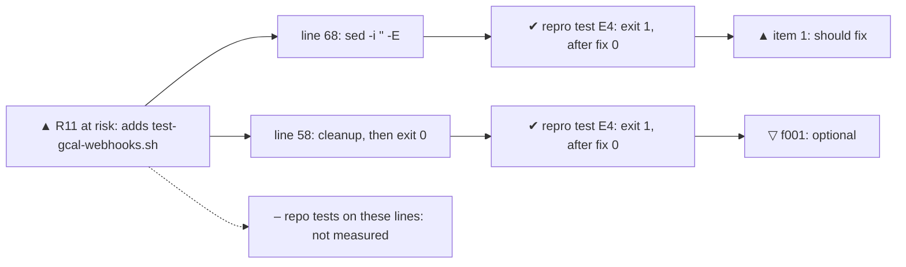

Report UX design, 2026-11-26 (second pass): how arbiter and e2e-judge report to a human, in every situation they
hit, so the reader absorbs more by reading less. This file is the design. The evidence lives in five source files,
cited here by their keys:

| File | Keys | Scope |
|---|---|---|
| [research-report-cognition.md](research-report-cognition.md) | RC1–RC56, findings F1–F59 | cognitive load, visual encoding, scanning, accessibility and ADHD, SE studies on review output, coverage and alerts |
| [research-report-prior-art.md](research-report-prior-art.md) | RP01–RP55, patterns P1–P23 | 33 tools: coverage, mutation, test reports, traceability, AI review, SARIF, risk maps, branch views |
| [research-report-render-stack.md](research-report-render-stack.md) | RS1–RS39 | single-file HTML, escaping and CSP, diagram and JSON-viewer libraries with measured sizes, generative-UI specs, data standards |
| [research-report-components.md](research-report-components.md) | RM1–RM104, findings M1–M31, U1–U27, G1–G12 | agent-to-human rich text, the five markup components, UML and diagram comprehension, Mermaid on GitHub; a table of what was re-read |
| [research-report-situations.md](research-report-situations.md) | RA1–RA57, findings A1–A23, situations S1–S8 | how production agents and human-AI research shape a message per situation: final result, progress, decision, failure, handoff, research answer, change summary, alert |

Visual proof, built by hand. Checked in headless Chromium at 1440 px and 390 px: no sideways page scroll, no
network request, no console error.

| Mock-up | Situation | Data | Default view at 390 px |
|---|---|---|---|
| [mockups/report-calcom.html](mockups/report-calcom.html) | S1 final report, offline | real cal.com run; one folded, hatched sample panel | **1,958 px**, 334 words (first pass: 7,366 px, 1,208 words) |
| [mockups/report-calcom.md](mockups/report-calcom.md) | S1 as a PR comment, one Mermaid diagram | real | 18 lines above the first fold, 118 in all (old report: 185). Not posted to GitHub. |
| [mockups/report-incomplete.html](mockups/report-incomplete.html) | S4 INCOMPLETE, verdict withheld | sample, flagged; the rule is real | 1,926 px, 320 words |
| [mockups/progress-live.txt](mockups/progress-live.txt) | S2 live progress, TTY and CI log | counts real, stage times sample | 1 status line + 1 line per stage |

# Report UX

## 1. Problem: the report makes the reader do the work

A report is read by a human who has to decide one thing: merge, fix, or check by hand.

Measured on `eval/results/martian/20261123233602/calcom-cal-com-pull-22532/` (pre-Wave 2a format):

| What | Measured |
|---|---|
| Length | 185 lines for 8 findings, none of them blocking |
| Repetition | 15 gate lines (eslint, semgrep and tsc once per package root), before any finding |
| Density | each finding is one bullet of 400–800 characters: tier, axis, evidence level, claim, fix, proof command, absolute proof path and output |
| Decision | the verdict (PASS) sits in the title; nothing says what to do next |
| Hidden unknowns | `rejected.json` holds 4 candidates dropped by intake rules, one raised as a blocker; none appears in the report |
| False comfort | eslint, tsc and `npm test` read "ran, exit 1 / 127". The command ran, the tool did not (evidence below). |
| Silence | stdout during the 27 min 46 s run: one line, the run path (`arbiter/pipeline.py` `run_all`) |

Gate evidence, from the run's files:

| File | What it shows |
|---|---|
| `gates.json` | 15 results, all `status: ran`: eslint × 5 exit 1, tsc × 4 exit 1, `npm test` × 1 exit 127, semgrep × 5 exit 0 |
| `exec/<exec_id>.json` | eslint: stderr `npx canceled due to missing packages and no YES option: ["eslint@10.15.0"]`, stdout 0 bytes. tsc: `npm error code ENOTCACHED … registry.npmjs.org/tsc`, stdout 0 bytes. `npm test`: `sh: 1: jest: not found`. Each of the ten runs ended in 1.4–4.6 s. semgrep: 1.4–2.1 KB of JSON with the scanned paths. |
| `sandbox.json` | 10 of 10 `npm install --ignore-scripts --no-package-lock` fetches exit 1 (5 roots × head and base); `status` still reads `ready` |
| `coverage.json` notes | "dependency fetch failed in wt/packages/…" once per root, with npm's `ERESOLVE` report |

So "never executed" holds for the *tools* (eslint, tsc, jest) and is wrong for the *commands* (npx, npm). The report
word is **no result**, with the exit code beside it (D11).

The Wave 2a format (`arbiter/report.py`) fixed the order: verdict, next action, requirements table, tiers, folds.
Each finding is still a prose block, nothing shows branches or tests, and the last three rows above still hold.
The first pass of this design fixed the content and stayed long: 7,366 px at 390 px.

## 2. Evidence: nineteen rules

Strength as in RC §3: **strong** = meta-analyses or replicated experiments; **moderate** = single controlled studies
or large field data; **weak** = small or one-off; **opinion** = guidance with no direct experiment.
"Re-read" = the author found the number in the source in the second pass (RM file, table at the top).

| # | Rule | Evidence | Strength |
|---|---|---|---|
| E1 | **Cut, don't restyle.** Removing material that does not change the decision is the largest measured effect: coherence d = 0.86 (re-read). A concise rewrite of web text cut task time from 359 s to 209 s; concise + scannable + objective reached 149 s and errors 0.82 → 0.10, n = 51 (re-read). | RC F3, F9, F19 | strong |
| E2 | **Outcome, reason and next action first**, then the failed conditions only. The Army standard is "a single rapid reading". | RC F19–F29; RP P1; RA A1 | moderate |
| E3 | **Evidence next to its claim, and evidence means the command and its output.** Claim, `file:line`, a short snippet, the proof run and the fix in one block; no "see appendix". | RC F6 (g = 0.63, re-read); RA A3 | strong |
| E4 | **Overview, then details on demand, at most 2 folds deep.** | RC F13, F22; RP P14 | moderate |
| E5 | **Few items, hard cap.** Working memory holds about 4 chunks. Reminder acceptance drops 30% per extra reminder. High-signal AI reviews cluster at 1–3 comments; PRs reviewed only by bots merged 45% vs 68% for human-only review (all re-read). | RC F2, F44; RP P13, RP46 | moderate (cap value is opinion) |
| E6 | **Never colour alone.** Glyph + word + colour-blind-safe colour (Okabe-Ito, not red/green). WCAG 1.4.1 is Level A. | RC F30, F57–F59 | strong (normative) |
| E7 | **Quantities as position or length** (bars, dot rows), never pies, area or hue intensity. | RC F11, F12 | strong |
| E8 | **Coverage must not read as "tested".** Coverage views made 30 professionals overestimate their tests (p = 0.026) with no more faults found (re-read). Show *exercised* and *asserted* apart. | RC F46; RP P10 | moderate (one study) |
| E9 | **Order decides attention.** Reviewers primed by an LLM review found more low-severity issues and no more high-severity ones (re-read). | RC F51 | moderate |
| E10 | **Message-bearing headings** ("3 requirements lack an oracle", not "Coverage"). | RC F4, F16, F21 | strong / moderate |
| E11 | **Anchored and short gets acted on.** After a hunk-level AI comment the file was modified in 44% of cases, after a file-level one in 14% (a proxy for "acted on"; re-read). | RP §2e | moderate |
| E12 | **Diagrams only when they earn it.** CodeRabbit's default sequence diagrams were judged too long and switched off. No study tests auto-generated diagrams in review bots. | RP P21; RM U26 | weak (user reports) |
| E13 | **Show the unknowns, in plain first-person words.** List what the agent could not verify. "I'm not sure" phrasing cut overreliance on wrong answers; a bare probability word is misread, so confidence is a fixed word tied to an action (proven → fix; unverified → check). | RC F35, F46, F51; RA A5–A7 | moderate |
| E14 | **A table for anything with 2+ attributes.** The same facts as a table beat text: d = 0.39 (n = 2,305); 70% vs 8% correct. At most 5 columns and 10 visible rows, one line per cell. | RM M1, M2, M16 | strong (caps are opinion) |
| E15 | **Design for the worst renderer.** GitHub Mobile shows Mermaid as source and may expand folds; an alert inside a fold is a plain quote; comments lose `style`, `class`, `<svg>` and `data:` images. | RM M21, M27, M29, G2, G3 | moderate (platform) / weak (user reports) |
| E16 | **Size and layout decide whether a diagram is understood, not the notation.** 30–60 elements is the recommended range (re-read); layout flaws cost more than size; above 20 nodes a table wins except for path-following (re-read); UML documentation gave +54% correctness and no time saving. | RM U1–U4, U10, U21 | moderate |
| E17 | **Length is not neutral.** Longer explanations raised readers' confidence in LLM answers without raising accuracy. The default view shows what needs the reader and nothing else. | RA A4 | moderate |
| E18 | **The situation picks the shape.** A final result, a progress line, a decision request, a failed run and an alert answer different questions; each gets its own ordered shape and budget (§3.10). | RA §3 | opinion (convergent practice) |
| E19 | **Past 10 s, show progress; say at once when a result is lost; interrupt only for something actionable.** Step counts beat a percentage the agent cannot keep moving. | RA A10–A14 | moderate / opinion |

Where the rules pull against each other, the design takes one side on purpose:

| Tension | Resolution |
|---|---|
| E13 (show unknowns) vs E17 (short) | One list holds everything the reader must do: proven fixes first, then checks. It never folds and is never truncated; everything else folds. |
| A requirement matrix (E14) vs E17 | The matrix repeats the needs-you list from another angle. It is one fold away, under a one-line count and a 14-cell strip; a wide screen opens it. |
| E12 (no default diagrams) vs the engineer who wants flows and states | Every diagram has a trigger rule, a size budget and a text twin; it lives in an L2 fold; a PR comment carries at most one (§3.8). |
| E1 (cut) vs E3 (evidence beside the claim) | Evidence stays, inside the item's own fold. Repeats are cut: 15 gate lines become 4 rows. |
| E5 (hard cap) vs E13 (completeness) | Findings are capped per tier. Check lines are never dropped: they merge by root cause, then group by kind. |
| E8 (coverage is not "tested") vs a simple matrix | A review-only run says "no conflict found", never "met". "Not measured" is said once per run, not once per cell. |
| Vendor defaults against bullets and bold (RM M12, M13) vs a structured report | Those govern chat answers. A report is reference material that is scanned and compared; the shared rule is "format only to aid scanning" (RM M14). |

ADHD specifically: the evidence is thin (working-memory deficit is moderate across 38 studies; the typography study
had n = 6; no study tests report formats with ADHD developers). The defensible design target is **low working
memory and short attention bursts**, which COGA and the BDA guide both describe as universal design (RC §3 notes).
Do not claim the design is ADHD-validated.

## 3. Design: four layers, five components, five diagrams, eight situations

### 3.1 Layers: the default view holds only what needs the reader

One page, four layers. Nothing below a layer is needed to act on it.

| Layer | Reader | Question (answered in < 5 s) | Holds | Default |
|---|---|---|---|---|
| L0 | decider | Can I merge; what do I do next? | verdict line: glyph + word, one reason, one imperative next action, tier counts with the **count of unverified items** | always shown |
| L1 | decider | What exactly must I do? | the needs-you list (§3.6): must-fix and should-fix items, capped, then every check. One line of requirement counts with a strip (§3.2). One "not measured" line. | always shown |
| L2 | engineer | Why, for one row? How does it flow? | evidence block per item; requirement matrix; gates; optional findings; candidates; units; effort; branch strip (§3.4); diagrams DG1–DG5 on their triggers (§3.8) | folded; on a narrow screen under one outer fold |
| L3 | engineer, tools | Show me the raw data | JSON viewer on `report.json`, SARIF, mutation report, logs | folded |

| Rule | Detail | Basis |
|---|---|---|
| Budget | Verdict and next action fit the first phone screen. The whole default view stays within about 2,000 px at 390 px for up to 7 items `[INFERENCE]`. Measured on cal.com: 1,958 px, 334 words. | E17; D12 |
| Wide screen | At 1000 px and wider the requirement matrix and the engineers' fold start open, beside and below the list. | E4 |
| Stable layout | Same order, glyphs and positions in every run. | RC rule 17 |
| No legend in the default view | Every glyph carries its word. The legend sits in the last fold. | E17; RM M17 |

### 3.2 Requirements: one line at L1, the matrix at L2

L1 shows the counts ("14 requirements: 1 at risk, 6 need a human") and, in HTML, one cell per requirement.
The matrix is one fold away. One row per requirement (`R…` from commits/issues/specs, `B…` from repo rules);
the requirement cell is the id and a title of at most 8 words. Sample data:

| Requirement | Status | Branches | Tests, oracle | Item |
|---|---|---|---|---|
| R1 refund over the limit returns 409 | ✔ met | ◆ asserted 1/1 | 2, ✔ O3 | none |
| R2 closed account is refused with 403 | ▲ at risk: 403 never asserted | ◈ covered, not asserted | 2, ▲ O1 | 1 |
| R3 retry on a 503 from the gateway | ○ needs a human: no test reaches it | ◇ side never taken | 0 | 4 |

| Rule | Detail | Basis |
|---|---|---|
| Status is computed, never written by a model | ✖ not met: a must-fix finding addresses it. ▲ at risk: a should-fix finding. ○ needs a human: a verify-tier finding, an unverified candidate or an open e2e question. ✔ met: only with e2e evidence at E3 or above. ✔ no conflict found: a review-only run where the spec check ran and none of the above holds. | RP P3; E8 |
| Size | ≤ 5 columns. ≤ 10 visible rows; rows with no problem fold under a count ("no conflict found on the other 7"). | E14, E5 |
| Missing data | Without e2e-judge data the Branches and Tests columns are dropped and one L1 line says "not measured: branches, tests, oracle strength". | E8, E13 |
| Transitive risk | A requirement at risk only because another row's finding breaks it gets a transitive mark and a link to the root, so one bug does not look like five. | RP P4 |
| Missing links | Without `addresses` on findings the Item cell reads "not linked", never ✔ (decision D10). In the mock-ups the ids R1–R14 and every finding-to-requirement link are a **hand join**, labelled as such. | E13 |

On the cal.com run: 14 requirements, 1 at risk, 6 needing a human, 7 with no conflict found; 7 rows shown.

### 3.3 Requirement trace (L2, diagram DG1)

For one requirement, a fixed 4-column graph: requirement → code location → test, obligation or proof run → finding.
Column order never changes, so the layout needs no engine: hand-drawn SVG (RS R3). Never a whole-repo graph
(RP §4.2 rank 5). In a review-only run the third column holds arbiter's proof runs, and a dashed node says that
repo tests on those lines were not measured. Real data, cal.com R11:

### 3.4 Branch strip (L2)

Per changed function, one diamond per decision, after JaCoCo and Istanbul (RP P8), with the missing side named:

- ◆ both sides taken **and** a targeted mutant killed: asserted.
- ◈ both sides taken, mutant survived: **covered, not asserted** (E8). This split is arbiter's differentiator; no
  surveyed tool joins decision outcomes to the tests that take them per PR (RP §2h).
- ◇ one side never taken: name it (`if resp.status == 503` → true side never taken).

Each line gives the state word, `file:line`, the condition, the tests on each side and the mutant result. Compound
conditions expand to a small decision table (after llvm-cov MC/DC vectors, RP07). Source: e2e-judge's obligations
(`action` = none/default/error/delegate/user-message/emit) and its mutants; for review-only runs the section reads
"not measured" (decision D3). The strip is the text twin of the activity diagram DG2.

### 3.5 Finding card: one line in the list, an evidence block in its fold

A finding is a row, not a card in the UI-kit sense (RM28).

| Part | Content | Cap |
|---|---|---|
| L1 line | tier glyph + word, header of ≤ 5 words, then `path:line`, axis, requirement, evidence word and rung | 2 lines |
| Why | one sentence under the line | ≤ 25 words |
| Fold: code | the cited lines with line numbers, the cited line marked | ≤ 6 lines |
| Fold: proof | the command; before and after the fix: exit code and last lines of output | ≤ 3 lines per side |
| Fold: rest | trigger, fix (patch when one exists), why the expected result is expected, sources, other locations | — |

Order by tier, then proof result (E9; GitHub's severity × precision, RP P12). Cluster findings that share a root cause
into one row with a count (RP P16). A data-flow finding shows a numbered source → sink path, and the sequence diagram
DG4 only when the path crosses files (RP P17). Never print an absolute local path.

Caps, enforced in code, not in prompts: all must-fix; at most 5 should-fix, then "+N more"; optional and
pre-existing as one count line each, listed in a fold. Repeated gate rows collapse to one row per gate with a run count.

### 3.6 The needs-you list (L1): fixes, then checks

The one callout of the report. It holds every thing the reader must do. The first pass kept proven findings and
unverified checks in two lists and a matrix beside them; one list says it once.

| Rule | Detail | Basis |
|---|---|---|
| Content | (a) must-fix and should-fix findings, as the L1 lines of §3.5. (b) Checks: verify-tier findings; requirements that need a human; gates that gave no result; **candidates an intake rule dropped without judging their merit**; axes and file types with no check; a threat model arbiter drafted itself; open e2e questions. | cal.com run; E13 |
| Order and marks | fixes first, then checks; numbered through; ▲ / ✖ with "fix", ○ with "check". The numbers are the cross-reference ids ("item 4"). | E9; RA A2 |
| Placement | once, top level, never in a fold. Its count of checks is on the verdict line. | RM M20, M21 |
| Size | one line per root cause, never truncated; above 7 lines, group by kind with counts | E5; RM20, RM56 |
| Wording | each line is a focused instruction: an imperative of ≤ 8 words, one sentence of why, one anchor. A focused instruction raised detection odds 8×; a checklist on top added nothing significant. | RM55 |
| Clean run | no list; the verdict line says "nothing needs you" | RM1 (alerts only when crucial) |
| Form | GitHub: `> [!IMPORTANT]` with a task list. HTML: a labelled section with real checkboxes on the checks. | RM §3.5 |
| Cost | The interventions that cut overreliance most are liked least. The list is friction on purpose. | RA A23 |

On the cal.com run the list has 7 lines: 1 should-fix; 1 check for the three gates with no result (one root cause:
`npm install` failed in 5 of 5 package roots); 3 unverified spec doubts; 1 unverified test gap; 1 for scope limits.

### 3.7 Five components carry every layer and every situation

Chosen in RM §3 from ten candidates; runners-up in RM §4; the check against S1–S8 in RM §3.6 and RA §5.

| Component | L0 | L1 | L2 | GitHub markdown | Offline HTML | Cap |
|---|---|---|---|---|---|---|
| Verdict line | verdict, reason, next action, counts | the status word on every row | the same words on gates and branches | heading + bold counts | `<h1>` in a coloured band | ≤ 4 verdict values (BLOCK, PASS with follow-ups, PASS, INCOMPLETE); 1 line |
| Table | — | — | requirement matrix, optional findings, gates, units, transitions | pipe table | `<table>` with `scope` | ≤ 5 columns, ≤ 10 rows, one line per cell |
| Evidence block | — | item line with `path:line` | snippet, before/after, fix | SHA permalink + fenced code + 2-row table | `<pre>` with line numbers and `<mark>` | ≤ 6 code lines; ≤ 3 output lines per side |
| Fold | — | — | every L2 view | `
`, 1 level | `
`, ≤ 2 levels, open-all, open on print | summary = message + count, ≤ 45 characters |
| Callout | — | the needs-you list | never | `> [!IMPORTANT]` | labelled section | exactly 1, or 0 on a clean run |

Two additions, outside reports: a **status line with a stage list** for live progress (S2) and **numbered options**
inside the callout when a decision is asked (S3).

One status vocabulary in every renderer (RM23: fewest statuses, adjectives, same glyph and word everywhere):

| Glyph + word | Meaning | Colour in HTML (Okabe-Ito) |
|---|---|---|
| ✖ must fix / not met | proven blocker | vermillion `#D55E00` |
| ▲ should fix / at risk | proven, not blocking | orange `#E69F00` |
| ○ needs a human / check | raised, not verified | reddish purple `#CC79A7` |
| ✔ no conflict found / met / ran clean | checked | blue `#0072B2` |
| ▽ optional | nit | sky blue `#56B4E9` |
| – not measured / no result / INCOMPLETE | no data | grey, dashed outline |

The `🔴 🟢 🟡 ⚪` circles of today's `report.py` differ only by hue and pair red with green: replace them (E6).

### 3.8 Five diagrams, each with a trigger, a budget and a text twin

UML is for the engineer at L2. The table is always there; the diagram is added when the question is about a path
or an order (E16). Full evidence, Mermaid sources and the not-emitted list: RM §5.

| # | Diagram | Question | Trigger | Data | Budget | Text twin |
|---|---|---|---|---|---|---|
| DG1 | Requirement trace (SysML requirement diagram, 4 fixed columns) | Why is this requirement at risk; what proves it? | status is not "no conflict found" and ≥ 2 linked artefacts | `requirements`, `locations`, `tests`, `findings`, `evidence` | ≤ 13 nodes | its matrix row |
| DG2 | UML activity diagram of one changed function | Which paths exist; which did a test take and assert? | ≥ 2 decisions and one is ◈ or ◇, or a finding sits on a branch | `branches`, `obligations` | ≤ 12 nodes, ≤ 6 decisions | branch strip |
| DG3 | UML state machine, flat | Which transition has no test? | `state` obligations exist, or the diff changes a status field | `obligations`, `tests` | ≤ 8 states, ≤ 12 transitions | transition table |
| DG4 | UML sequence diagram | How does the value travel between units to the failure? | a must-fix or should-fix finding with a path of ≥ 3 steps across ≥ 2 files; or a `delegate` obligation | `findings[].path`, `evidence` | ≤ 5 lifelines, ≤ 10 messages | numbered path |
| DG5 | UML component diagram of touched units | Which parts are touched; which depend on each other? | ≥ 3 units and recorded dependency edges | `coverage.units`, `coverage.decompose` | ≤ 9 components, ≤ 12 edges | units table |

| Rule | Detail | Basis |
|---|---|---|
| Budget | every diagram ≤ 15 nodes, ≤ 20 edges, ≤ 45 elements, counted in code; over budget, the twin stands alone with "diagram omitted: N nodes" | RM U1–U3 |
| Small by construction | one requirement, function or finding per diagram; asserted runs collapse into one node; names and one status per node; labels ≤ 32 characters | RM U12, U16 |
| Layout | one flow direction, zero crossings by row order, related nodes adjacent; ≤ 6 symbol kinds | RM U4, U7, U20 |
| Status in a diagram | glyph + word in the label, line style for "never taken" (dashed); colour last | E6 |
| GitHub | Mermaid `flowchart` (DG1, DG2, DG5), `stateDiagram-v2` (DG3), `sequenceDiagram` (DG4): stable since v10. No beta types, no C4 syntax, no theme. `accTitle` + `accDescr`. In a fold, after the twin. At most one per comment: DG4 for a must-fix with a path, else DG2 for the worst branch state, else DG1 for the worst requirement, else none. | RM G2–G9 |
| HTML | hand-drawn inline SVG, one fixed layout per kind; `<figure role="group">` + `<svg role="img">` with `<title>` and `<desc>`; scrolls in its own region when narrow | RM G10–G12; RS R3 |
| Not emitted | communication, class, C4 context or container, nested states, whole-PR graphs, raw traces | RM §5.3 |

On the cal.com run only DG1 triggers. The mock-up shows DG2 on sample data, inside the folded sample panel.

### 3.9 The same report on four renderers

| Element | Offline HTML | GitHub web | GitHub Mobile, e-mail (worst case) | Terminal |
|---|---|---|---|---|
| Verdict line | `<h1>` in a band | heading + counts | same text | one line; takes the place of the live status line |
| Needs-you list | numbered list, checkboxes | alert + task list | plain quote | numbered list |
| Requirements | count line + strip; matrix in a fold | count line; pipe table in a fold | table, expanded `[unverified]` | count line |
| Folds | `
` | `
` | shown expanded | left out; path to `report.html` |
| Evidence block | `<pre>` + `<mark>` | permalink snippet + fenced code | code block + link | top must-fix only |
| Diagram | inline SVG | one Mermaid block | source text under its twin table | none |

The first screen of the PR comment is plain text and one quote block, so it reads the same in every column (E15).

### 3.10 Eight situations: what arbiter and e2e-judge emit in each

Shapes, budgets, evidence and "never" lists: RA §3. Which output is which situation: RA §4.

| Situation | arbiter / e2e-judge output | Shape, in order | Budget | Mock-up |
|---|---|---|---|---|
| S1 final result | `report.html`, `report.md`, the last stdout line; e2e-judge's final message | verdict + reason → next action → needs-you list → folds | ≤ ~2,000 px at 390 px; ≤ 20 lines above the first fold | report-calcom.html, .md |
| S2 progress | stdout for the whole run; `progress.jsonl` | status line (stage k/9, counter, elapsed, typical range, last-event age) → one line per finished stage with its result → a warning the moment a result is lost → proven findings as they are proven | 1 line live; 1 per stage | progress-live.txt |
| S3 decision | the `decision: <why>` reply; `--decide` challenges; e2e-judge "Open questions" | the question, closed → recommended option first → ≤ 4 numbered options with the consequence of each → what happens with no reply | ≤ 6 lines per question | RA §3 S3 |
| S4 failed, partial | INCOMPLETE (exit 5); exit 2, 3, 4; gates with no result; obligations blocked on questions | state word → what failed and the exact error → what was tried → what still stands → what is not known → the needed action as a command, with its cost | ≤ 10 lines before the lists | report-incomplete.html |
| S5 handoff | the PR comment; `report.json`, SARIF; e2e-judge "Owed" | S1 shape + goal, decisions made, next steps in order, pointers by path. To an agent: `report.json`, no prose. | ≤ 25 lines | RA §3 S5 |
| S6 research answer | evidence words on findings ("proven E4", "precedent") | the word, then the rung; the scale defined once in the last fold | 1 line | — |
| S7 change summary | units and files; e2e-judge freeze | units table with churn bars and findings; DG5 on its trigger | ≤ 10 rows | report-calcom.html, Units fold |
| S8 alert | exit 1 on BLOCK in CI | one line: `✖ BLOCK · n proven blockers · first path:line · report link`. No alert on PASS, on follow-ups or per finding. INCOMPLETE alerts once, as "no verdict". | ≤ 3 lines | RA §3 S8 |

| Rule | Detail | Basis |
|---|---|---|
| arbiter still never asks mid-run | S3 applies to its outputs (the `decision:` reply, e2e questions), not to prompts during a run. | README; RA A19 |
| Early warning | When the sandbox or a gate loses a result (cal.com: `npm install` fails in minute 1), the progress view says it then, with the consequence. Today the reader learns it from a note in a fold after 28 minutes. | RA A14, A22 |
| No percent, no single ETA | Stage lengths differ by two orders of magnitude; show stage k of n, a real counter, elapsed time and the range of past runs. | RA A10, A11 |
| INCOMPLETE is its own state | grey and dashed, never the pass or block colour; "not a PASS and not a BLOCK"; proven findings that completed are kept and marked as standing. | RA A20; `arbiter/pipeline.py` `_withhold` |
| A rerun's cost is said | arbiter has no resume: "a rerun starts from zero, about N minutes". | RA A20 |

## 4. Data: one report model, four renderers

The renderers read one versioned `report.json`; they never read model output directly (RS R1). Proposed top level
(full sketch: RS §3):

| Key | Content | Source today |
|---|---|---|
| `schema` | `arbiter.report/1`; renderers refuse unknown majors | new |
| `run` | repo, base, head, effort, models, wall time; **`state`**: complete, incomplete (with the reason and the failed-call counts) | `plan.json`, `coverage.json`; `state` is new |
| `verdict` | verdict, next action, tier counts, **unverified count**, one-line reason | `report.py` (computed) |
| `needs` | ordered items: kind (fix, check), instruction, reason, anchor, finding or requirement ids | new: tiers, `rejected.json`, `gates.json`, `coverage.json` notes |
| `requirements` | id, title (≤ 8 words), text, source, derived status and reason | `intent.json` |
| `locations` | file, lines, symbol, change kind | findings' `file`/`line`, diff |
| `branches` | location, condition, outcomes with `test_ids`, mutant result | e2e-judge (obligations, mutants); missing for review-only runs |
| `tests` | name, file, status, obligation ids, oracle grade | e2e-judge `judge.json`, `evidence.json` |
| `obligations` | requirement, clause, action, technique, test ids | e2e-design `*.obligations.json` |
| `findings` | tier, axis, rule, **header**, claim, location, requirement, evidence ids, sarif level, **path** (ordered steps, as SARIF `codeFlows`) | `final.json`; `header` and `path` are new |
| `evidence` | command/diff/log/mutant/quote text, exit code | `proved.json`, proofs dir |
| `judge` | STRONG/GAPS/WEAK, rubric R1–R13, gaps, open questions with options | e2e-judge `judge.json` |
| `coverage` | gates with **`result`** (clean, findings, none) apart from the exit code, axes, units, agent runs | `coverage.json`, `gates.json`, `exec/` |

A gate's `result` is `none` when the launcher failed before the tool started: exit 127, npx "missing packages",
`ENOTCACHED`, or empty output where the tool always prints. `progress.jsonl` (one event per stage change, warning
and proven finding) feeds the live view and any tool that watches a run.

Chain: requirement ← obligation → test → branch outcome → location ← finding → evidence. No open standard carries
the whole chain (RS §2.7), so `report.json` stays the source of truth and arbiter exports SARIF for findings (GitHub
code scanning UI, diff-only annotations) and optionally CTRF for tests and the Stryker mutation schema for mutants.

## 5. Render stack

| Decision | Choice | Why |
|---|---|---|
| HTML | stdlib Python writes one `report.html`: data in `` renders as text; no sideways page scroll at 390 px; default view ≤ 2,000 px at 390 px on the cal.com run |
| U3 | e2e-judge writes `obligations`, `tests`, `branches`, `judge` into the same schema; branch strip and DG2; open questions as numbered options (S3) | a judge run shows ◆/◈/◇ per decision with the test names, DG2 only when its trigger holds, and each question with ≤ 4 options and its no-reply outcome |
| U4 | SARIF export; optional CTRF and Stryker-schema exports | GitHub code scanning accepts `report.sarif` |
| U5 | Reader test: time to answer 5 fixed questions (merge? what blocks? which requirement is untested? which branch is never taken? what must I check by hand?) on old vs new report, 3 runs | median time down and answers right; the caps and budgets above are opinion or inference until this is measured |
| U6 | `findings[].path`; DG3, DG4, DG5 with their text twins; one Mermaid block in the PR comment by the §3.8 priority | each diagram is refused over budget; one test comment on GitHub confirms the alert, the task list and the Mermaid block render |
| U7 | Live progress (S2): stage events in `progress.jsonl`; TTY status line and stage list; plain lines when not a TTY; warning when a gate or the sandbox loses a result | on the cal.com fixture the warning prints before the gates stage ends; no output line is repeated; `NO_COLOR` and non-TTY give plain text |
| U8 | Failed runs (S4) and the alert line (S8): INCOMPLETE report in the S4 shape; one-line BLOCK and INCOMPLETE summaries on stdout; `sandbox.json` status reflects failed installs | matches `mockups/report-incomplete.html`; exit codes unchanged (README table); a run with every install failed does not report `ready` |
